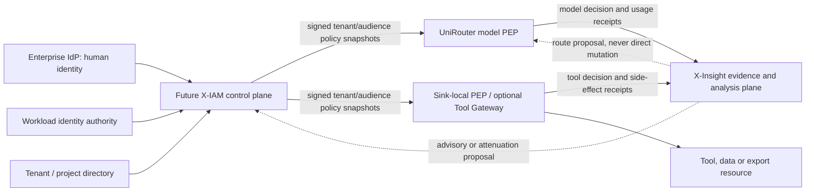

# Phase 2 X-IAM, Tool Gateway And Cache Authority Boundary

Status: recommended architecture boundaries accepted 2026-07-13; dependent
runtime scope and exact parameters not implemented
Date: 2026-07-13
Decision owner: User
Analysis owner: Codex
X-Insight analysis baseline: `b287874e544fa96ff0af9751ea6dda57d05e9cf6`
UniRouter analysis fact baseline: committed `main` at
`fbfde8816a6a6676cd0c65a489659d246c5541fd`
Decision update: B0-D13 through B0-D22 accepted as boundary defaults on
2026-07-13; exact SLOs, action classes, spool behavior, privacy/versioned
contracts and Tool Gateway build/reuse/defer remain unresolved

## Answer First

The recommended product shape is one product family with separate runtime
trust boundaries:

1. **Do not implement X-IAM now.** If evidence later justifies it, X-IAM should
   be an independent identity and policy control plane. It may share brand,
   navigation, packaging or infrastructure with X-Insight at small scale, but
   its process, database, key custody, authorization truth and grant/revoke
   authority remain isolated. Co-deployment still shares host/network/upgrade
   failure and must be reported honestly.
2. **The true sink/action owner must contain the data-plane PEP.** A Tool
   Gateway is one possible logically independent deployment, alongside a
   database proxy, export service or resource-embedded PEP. It belongs in
   neither X-Insight nor X-IAM. Long-lived credentials remain in Vault/KMS or
   the resource owner; the PEP obtains bounded references/tokens, validates an
   independent approval and performs final side-effect mediation.
3. **The action owner computes and enforces contextual authorization.**
   Identity, policy, entitlement and resource authorities provide inputs; a
   local PDP/decision engine computes the action-specific result; the PEP
   enforces it immediately before commit. X-Insight stores historical
   decisions, not current authorization truth.
4. **Cache invalidation is logical first, physical second.** The authority
   commits and publishes a monotonic subject, policy or resource epoch. A PEP
   rejects older entries only after it observes the new epoch; convergence is
   bounded by the accepted propagation/acknowledgment/TTL or shared-hard-state
   SLO. Physical deletion remains asynchronous. X-Insight may show or recommend
   invalidation but cannot perform it for other systems.

These recommendations are now accepted as B0-D13 through B0-D22 boundary
defaults. They remain non-capabilities: no X-IAM/Tool Gateway runtime, cache
control or feedback path is authorized or implemented by that acceptance.

## Verified Current Boundary

- X-IAM is a non-Git research corpus with no deployable identity issuer,
  policy publisher, PDP, revocation service or runtime cache. Its materials are
  explicitly reference inputs rather than an authoritative project PRD; see
  the [X-IAM source review](../discussion/x-iam-source-review-for-x-insight.md).
- No Tool Gateway project exists in the reviewed workspace. A Tool Gateway is
  an architecture candidate, not a schema reservation, adapter or deployed
  PEP.
- UniRouter's committed Agent capability is short-lived, attenuation-only and
  model-gateway-scoped. It grants no Tool, IAM, database, write or export
  authority.
- X-Insight owns normalized evidence, provenance and capture-gap inspection.
  It has no product authentication/RBAC, frontend, current-entitlement API,
  graph detector or control-plane write path; see
  [Runtime Contract Capability Status](runtime-contract-capability-status.md).
- The only approved UniRouter/X-Insight runtime boundary remains the
  operator-mediated sidecar. An internal UniRouter outbox is not an automatic
  X-Insight transport.

The following diagram is therefore a candidate future boundary, not current
deployment topology.



## X-IAM Placement Decision

### Recommended Shape

X-IAM should be a **logically independent control plane, deferred until a real
cross-PEP identity problem exists**. “Independent” means separate API and data
authority, signing-key custody, availability target, audit log and
grant/revoke change path. It does not necessarily mean a separate Kubernetes
cluster on day one. A small internal installation could share packaging or
infrastructure while preserving separate process, database, keys and authority;
that deployment still shares host/network/upgrade availability risk.

| Option | Benefits | Costs and failure risks | Judgment |
| --- | --- | --- | --- |
| Put X-IAM inside X-Insight | One UI/deployable; fewer early services; easy evidence linking | Evidence readers and analytics workers enter the authorization trust domain; X-Insight outage or compromise can affect grants; signing keys and historical evidence share a blast radius; scaling and retention needs conflict | Reject for an actual IAM runtime. Acceptable only for a read-only identity catalog with no keys or grant/revoke authority; then it is not X-IAM. |
| Independent logical control plane, optionally co-deployed first | Clear source of truth; separation of duties; policy and revocation SLO can differ from analytics; serves multiple PEP audiences | Another API/schema/HA/key-custody responsibility; eventual consistency and version rollout must be designed; higher operational cost | **Recommended future shape, but do not build yet.** |
| Remote PDP for every model/tool call | Central policy change is immediately visible; simplest conceptual consistency | Adds network latency and availability dependency to every action; Agent fanout creates an authorization avalanche; one outage becomes a global kill switch | Reject. Publish signed/versioned bounded policy state; a local PDP/decision engine evaluates and its PEP enforces. |

Build X-IAM only after at least two independent PEPs need shared identity,
policy and revocation, a real customer/operator is named, and root of trust,
issuer, policy authority, revocation SLO, key custody, HA/restore and migration
ownership are accepted.

This recommendation is not copied from an observability competitor. It is a
project-specific security architecture judgment aligned with
[NIST SP 800-207 Zero Trust](https://csrc.nist.gov/pubs/sp/800/207/final),
NIST's [software and AI agent identity concept
paper](https://www.nccoe.nist.gov/sites/default/files/2026-02/accelerating-the-adoption-of-software-and-ai-agent-identity-and-authorization-concept-paper.pdf),
and the distributed local-enforcement pattern documented by
[OPA management](https://www.openpolicyagent.org/docs/management-introduction)
and [signed bundles](https://www.openpolicyagent.org/docs/management-bundles).
Those sources support the pattern; none selects an X-IAM implementation for
this project.

## Tool Gateway Placement Decision

### Recommended Shape

Any component that reaches a protected network or commits an irreversible
action must place a **data-plane policy enforcement point at the true sink or
action owner**. A Tool Gateway is one possible deployment. It may run beside an
Agent runtime or reuse an existing MCP/tool gateway, but it needs an
audience-specific capability and must perform complete mediation immediately
before the side effect. Vault/KMS or the resource owner retains long-lived
credentials; an independent approval authority approves, while the PEP only
validates and consumes the approval.

| Placement | Benefits | Costs and failure risks | Judgment |
| --- | --- | --- | --- |
| Inside X-Insight | Investigation context is close to actions | Gives a read/audit platform production credentials and write authority; X-Insight analysis latency enters action flow; evidence compromise can become execution compromise | Reject. A read-only tool catalog can live in X-Insight, but it is not a Tool Gateway. |
| Inside X-IAM | Policy and enforcement appear centralized | Combines issuer/policy keys, tool credentials and side-effect authority in one blast radius; scales policy changes and tool traffic together; weakens separation of duties | Reject. X-IAM publishes policy; it does not execute tools. |
| Inside UniRouter by default | One gateway for models and tools | Expands UniRouter from model/economic gateway into credentialed action runtime; couples model availability to tool faults and changes accepted capability audiences | Reject as an automatic extension. A later jointly accepted product decision could co-deploy components while keeping audiences and PEPs separate. |
| Sink-local action-owner PEP, optionally deployed as an independent Tool Gateway | Bounded credentials and final resource state stay close; independent scaling and blast radius; complete mediation is possible | Another product/runtime surface may be needed; durable approval, idempotency, sandbox and connector security are substantial work | **Recommended logical boundary. A central Tool Gateway is not mandatory; build, reuse or defer remains a User decision.** |

The recommendation is supported by the least-privilege and final-action-owner
principles in [OWASP Excessive
Agency](https://genai.owasp.org/llmrisk/llm062025-excessive-agency/) and the
audience/scope/token handling rules in the [MCP authorization
guidance](https://modelcontextprotocol.io/docs/tutorials/security/authorization).
It is not a claim that MCP by itself supplies the required Tool Gateway.

## Authority Matrix

Static entitlement/grant inputs and an action-specific authorization result are
not interchangeable. The local PDP/decision engine computes the contextual
result; the PEP enforces it.

| Concern | Authoritative input owner | Local decision engine | Final enforcer | X-Insight role |
| --- | --- | --- | --- | --- |
| Human identity/status | Enterprise IdP | Target action owner's local PDP validates the accepted human binding | Target PEP | Store sanitized subject ref and evaluated version only. |
| Workload identity | SPIFFE/cloud/Kubernetes or another accepted workload authority | Target local PDP validates workload identity and audience | Target PEP | Store sanitized workload ref/version only. |
| Agent registration/delegation | Future Agent issuer/X-IAM; it may federate but cannot replace upstream human/workload truth | Issuer/STS derives attenuated audience capability; target local PDP validates it | Target PEP | Reconstruct delegation evidence/gaps; never mint authority. |
| Tenant/project membership | Tenant directory/project authority | Target local PDP binds tenant/project at decision time | Target PEP | Store evaluated tenant/project version. |
| Policy grant/epoch | One accepted authority per policy domain | Target local PDP evaluates a bounded signed snapshot | Target PEP | Record digest/version and expose stale/missing evidence. |
| Resource ACL/classification/version | Resource owner | Target local PDP combines current resource facts with other inputs | Resource/sink PEP | Analyze resource decision/action/outcome evidence. |
| Model admission/routing/budget/billing | UniRouter | UniRouter's local decision logic | UniRouter PEP | Investigate usage/decision provenance; never overwrite the ledger. |
| Tool/data/export side effect | Resource/action owner and any independent approval authority | Sink-local PDP checks contextual authorization and approval | Tool Gateway, database proxy, export service or resource-embedded PEP | Analyze decision/action/outcome receipts. |
| Evidence retention/deletion | Future accepted evidence-custody policy | X-Insight applies only its own accepted policy | X-Insight for its own store | No retention/deletion workflow or immutable deletion receipt is implemented yet. |

An audience is a hard boundary. A capability for
`unirouter-model-gateway` cannot authorize a tool call, database write or
export. A Tool Gateway must validate a capability for its own audience or use a
trusted token exchange that produces a more restricted target token. OAuth
2.0 Token Exchange provides a standards reference for subject/actor and
delegation semantics ([RFC 8693](https://www.rfc-editor.org/rfc/rfc8693.html));
it is not yet an accepted project dependency.

## How To Determine Whether Permission Still Exists

Every action, including a cache hit, binds the decision to:

```text
authenticated subject/workload
+ delegated Agent actor and workflow
+ tenant and target audience
+ action and final resource identity
+ subject_epoch, policy_version and resource_epoch
+ token/session expiry and hard revocation state
```

1. Enterprise IdP supplies human identity/status; a separate workload authority
   supplies workload identity. A tenant directory supplies project membership.
2. Future X-IAM may federate those facts and coordinate Agent registration/
   delegation, but cannot overwrite the upstream truths.
3. Each policy-domain authority publishes a signed, versioned, expiring bounded
   snapshot for the target audience. The resource owner supplies current ACL,
   classification and `resource_epoch`.
4. A local PDP/decision engine inside the action-owner trust boundary combines
   the current inputs and computes contextual effective authorization.
5. The sink-local PEP enforces the decision immediately before commit and emits
   a minimal receipt containing the result and evaluated versions. X-Insight
   receives that receipt asynchronously.

If X-Insight later displays permission, it must label the result a
**non-binding effective-authorization preview**, not “current entitlement.” The
preview includes `evaluated_at`, `expires_at`, an input digest and all evaluated
versions; the real action re-authorizes to avoid TOCTOU. The preview API needs
its own RBAC, tenant isolation, rate limit and audit-on-read because it can be
an authorization oracle. This requires a new versioned contract and is outside
Batch 1.

## Cache Enable, Read, Invalidate And Clear Authority

“Clear” has two distinct meanings:

- **logical invalidation** commits and publishes an epoch/version/tombstone;
  an old entry stops authorizing only after the relevant PEP observes it, with
  convergence bounded by the accepted propagation/acknowledgment/TTL or
  shared-hard-state SLO; and
- **physical cleanup** deletes bytes later and must never be required for the
  revocation SLO.

| Cache or record | Who may enable/configure it | Who may read it | Who triggers logical invalidation | Who performs physical cleanup |
| --- | --- | --- | --- | --- |
| Identity/root-authority cache | Identity authority and PEP security operator under an accepted TTL/SLO | Local PDP/PEP only; no end-user raw-cache API | Identity/root owner commits and publishes subject/root epoch | After observing the epoch, the PEP rejects old entries and evicts; background owner reclaims expired bytes. |
| Compiled policy snapshot | Tenant security admin through the one policy authority | Matching-audience local PDP/PEP; auditors see version metadata, not secret material | Policy authority commits/publishes a monotonic version/epoch or revoke | PEP atomically swaps after verification; operator may evict but cannot edit signed content. |
| Authorization decision cache | Each action owner under a short-TTL security contract; only when all decision inputs and obligations are safely cacheable | Local PDP/PEP internal use; X-Insight receives hit/miss/age metadata only if sanitized | Any observed subject, policy or resource epoch change, expiry or obligation change | The owning PEP; an allow entry never crosses an observed epoch/expiry. |
| Tool/result cache | Tool/data owner plus tenant admin; only side-effect-free, read-only, deterministic and explicitly cacheable results with defined freshness/consistency | Through the sink-local PEP after a fresh action authorization | Resource/security owner commits epoch/tombstone; a user may request a tombstone only within owned scope and cannot raise a shared epoch directly | Cache owner asynchronously removes values and emits a future contract-defined receipt. |
| LLM exact response cache | UniRouter or a separately accepted cache service; plaintext/raw caching is off in the current boundary | Only through UniRouter after current auth | Tenant/data owner; policy/data/model version changes | UniRouter/cache owner, never X-IAM or X-Insight. |
| X-Insight query/UI cache | X-Insight operator; multi-user use requires its own RBAC and tenant key | Authorized X-Insight session only | X-Insight RBAC, tenant or evidence revision | X-Insight clears only its own cache. |
| Audit/evidence records | Not a cache | Future accepted audit-on-read/export policy | Only a future accepted retention/legal-deletion workflow | Evidence custodian follows that future workflow; deletion receipts are not implemented now. “Clear cache” cannot erase audit evidence. |

Tool and model-result cache keys must bind subject, delegated actor, tenant,
audience, action, tool/model and cache-schema version, resource, subject/policy/
resource epochs, token/session expiry, approval ID/expiry where applicable and
input/argument digest. Bearer tokens, secrets and raw sensitive payload must not
be cache keys or values. A cached allow decision is forbidden when the decision
has a one-time approval, budget reservation, mutable resource, time/IP/risk
obligation or another input that cannot be safely revalidated. Idempotence alone
does not make an operation cacheable: write/send/delete/export must execute and
authorize even if retry semantics are idempotent.

## Failure Boundary

| Uncertainty or outage | Required behavior |
| --- | --- |
| Invalid token signature, issuer, audience, tenant or expiry | Fail closed. |
| Hard budget, resource authority or final side-effect permission unknown | Fail closed. |
| Baseline identity/tenant/grant snapshot unavailable or expired | An unexpired signed last-known-good baseline may continue but cannot widen privilege; new grants fail closed; fail closed after baseline expiry. |
| Hard revoke state cannot be confirmed | Fail closed for new admission. |
| Optional restrictive X-Insight risk overlay absent/stale | Fall back only to a still-valid baseline without widening authority; X-Insight absence cannot imply safe. An action whose policy requires fresh risk proof fails closed. |
| X-Insight unavailable | X-Insight delivery remains asynchronous. If a future contract defines mandatory receipts, the action owner first durably accepts them in its local ledger/outbox; diagnostic evidence may degrade with an explicit gap. |
| Tool Gateway unavailable | Tool action cannot execute; model routing should not fail merely because the tool plane is down. |
| Result cache unavailable | Bypass and call the source after authorization; a cache miss is never an allow decision. |

Here “durably accepted” means accepted by a future action-owner-local mandatory
ledger/outbox, never received by X-Insight. Mandatory receipts cannot be
replaced by a gap; only diagnostic evidence can be sampled or represented as a
gap. Whether a high-impact action fails closed when local mandatory durability
is unavailable remains open B0-D18. The recommendation is yes for material
writes, external sends, deletes, exports, privilege changes and financial
commitments. Model reads cannot be classified only by content risk because
they may still consume hard budget or create a financial obligation. The
bounded-spool, spool-full, disk-failure, local-outbox-failure and loss-alarm
behaviors require explicit contract and tests.

## Rationale For Prior Decision Questions 2 Through 5

This section answers the prior scalability-audit questions as well as the
separate D02-D05 product rationale. D02-D05 are already explained with direct
competitor attribution in the
[competitive-alignment report](../discussion/phase-2-competitive-alignment-and-recommendation-rationale-2026-07-13.md#recommendation-2--composite-opaque-execution-identity)
and were accepted on 2026-07-13. The four architecture questions below remain
open.

### Question 2 — Root Of Trust

**Recommendation.** Enterprise IdP owns human identity/status; an accepted
workload authority owns workload identity; a tenant directory owns membership;
resource owners own resource facts. Future X-IAM may federate those inputs,
coordinate Agent registration/delegation and issue audience-scoped derived
credentials, but cannot replace the upstream truths. UniRouter root keys retain
only model-gateway and economic scope.

**Why.** A gateway key proves access to a model service, not employment state,
resource ownership or authority to write another system. Reusing it creates a
confused-deputy path and makes UniRouter compromise equivalent to enterprise
identity compromise.

**Benefits.** Existing joiner/mover/leaver controls; smaller audiences and
blast radius; independent key rotation; clearer audit ownership.

**Costs.** Federation and token-exchange complexity; identity outages and
clock/epoch consistency must be designed; more principals and credentials to
operate.

**Source basis.** NIST agent identity/authorization and zero-trust guidance,
OAuth audience/token-exchange semantics, and project-specific UniRouter claim
boundaries. This is not copied from an observability competitor.

### Question 3 — Agent Identity Units

**Recommendation.** Keep distinct identifiers for Agent definition, running
instance, workflow, invocation and delegated child. Link them; do not overload
one `agent_id`.

**Why.** Definition answers “what code/config?”, instance answers “which
runtime?”, workflow answers “which business task?”, invocation answers “which
attempt?”, and child identity answers “whose attenuated authority?”. Collapsing
them breaks revoke scope, retry idempotency, forensic attribution and graph
cardinality.

**Benefits.** Precise revocation and budgets; retries do not look like new
identities; explainable delegation; safer graph queries.

**Costs.** More schema fields and joins; adapters may provide only a subset;
missing identity classes must be represented as gaps rather than inferred.

**Source basis.** NIST's Agent identity problem framing and X-Insight's own
provenance/gap model. Trace competitors validate run/span grouping but do not
define this security identity split for X-Insight.

### Question 4 — Revocation SLO

**Recommendation starting point.** A workflow revoke committed to shared hard
state rejects new admission through read-after-write; canceling an in-flight
request is a separate decision. Every other domain must measure authority
commit, publish, each required PEP observe/ack and new-admission rejection.
UniRouter's current 15-second root-authority refresh applies only to its Agent
capability path and is merely a candidate starting point for a future severe
revoke target, not a root/tenant-wide guarantee. Routine role/policy change may
use the signed snapshot TTL, with five minutes only a measurement starting
point rather than an accepted SLO.

**Why.** One universal TTL either makes every request contact the control plane
or leaves severe compromise active too long. Severity-class SLOs permit local
availability while bounding high-risk staleness.

**Benefits.** Measurable incident response; protects the hot path from a remote
PDP; fault tests can target explicit guarantees.

**Costs.** Epoch propagation, jitter, negative caches and mass-revoke load are
operationally complex; a local last-known-good snapshot is intentionally
eventually consistent. The proposed numbers need load and failure proof.

**Source basis.** OPA's distributed bundle/caching model plus the current
UniRouter 15-second root-authority cache and five-minute capability are pattern
inputs, not proof that these are correct product SLOs.

### Question 5 — Delegation Custody

**Recommendation.** The supervisor workload is authorized to request derived
capabilities; an issuer/STS and KMS hold signing/root secrets. Each child
receives a short-lived, audience-specific, attenuating capability with bounded
depth, budget and actions. Neither supervisor nor child receives a reusable
signing secret, and no reusable parent bearer is distributed to children.

**Why.** Agent fanout multiplies the number of places a credential can leak. A
root token in every child permits privilege amplification and makes selective
revoke impossible. Attenuation ensures a child cannot grant more than its
parent held.

**Benefits.** Least privilege; bounded blast radius; independent audience and
TTL; clearer delegation evidence.

**Costs.** Token exchange/refresh pressure; supervisor and issuer availability;
subject/actor semantics and clock skew must be handled. Parent, subject and
workflow revoke plus in-flight cancellation need distinct semantics.

**Source basis.** RFC 8693, MCP least-privilege token guidance,
[OWASP Excessive
Agency](https://genai.owasp.org/llmrisk/llm062025-excessive-agency/), and the
verified attenuation-only UniRouter capability. It is a standards-and-project
synthesis, not a copied competitor feature.

## Priority And Gate Judgment

| Priority | Judgment |
| --- | --- |
| Current P0 | None under the loopback, sanitized, manual-sidecar, read-only posture. Phase 1 stays closed. |
| Conditional P0 before public/multi-tenant/100x/Production | No remote per-call X-IAM/X-Insight; complete mediation at the final sink; audience isolation; epoch/revoke SLO; no reusable bearer storage; mandatory evidence cannot be starved by diagnostics. |
| P1 decision work | Define the unresolved B0-D13 through B0-D22 SLOs, action classes, failure semantics, privacy contracts and Tool Gateway implementation choice before dependent runtime expansion; preserve the bounded X-Insight API/UI and no-raw controls. |
| P2/decision-gated build | X-IAM runtime, Tool Gateway, live-entitlement API, signed policy distribution, tool/result cache, external queue and HA/DR. |

## Decisions Still Required

1. Keep X-IAM deferred; define its independent logical control-plane contract
   only when the accepted build triggers are met.
2. Choose whether Tool Gateway is built, an existing MCP/tool gateway is
   reused, or the capability is explicitly deferred.
3. Select the concrete enterprise IdP/workload identity authorities while
   keeping UniRouter authority audience-scoped.
4. Set numeric emergency, workflow and routine-policy revocation targets.
5. Select which actions fail closed when action-owner-local mandatory receipt
   persistence is unavailable.
6. Decide whether tool/result caching enters any near-term scope and which
   resource/action classes are never cacheable.
7. Name tenant policy, resource ACL and cache-purge owners.
8. Decide whether X-Insight may ever display a non-binding effective-
   authorization preview through a new read-only authority contract.
9. Accept or revise observed-epoch logical invalidation and asynchronous
   physical cleanup, including publish/ack/offline-node SLOs.
10. Keep route-proposal approval with UniRouter, tenant-policy approval with the
    policy authority and resource-policy approval with the resource owner.

## Related Records

- [Phase 2 Batch 0 Scope And Decision Register](../planning/phase-2-batch-0-scope-and-decision-register-2026-07-13.md)
- [Three-Product Scalability Anti-Pattern Audit](../discussion/unirouter-x-iam-x-insight-scalability-antipattern-audit-2026-07-13.md)
- [X-Insight Innovation And Golden Boundary Matrix](../discussion/phase-2-xinsight-innovation-and-golden-boundary-2026-07-13.md)
- [Phase 2 Product Priority](../planning/phase-2-product-priority.md)
