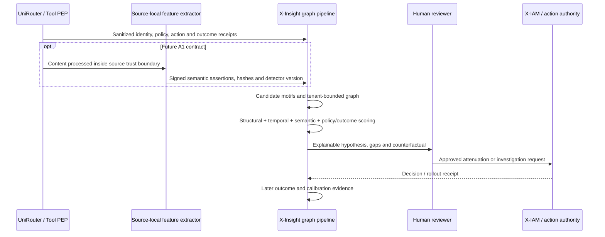
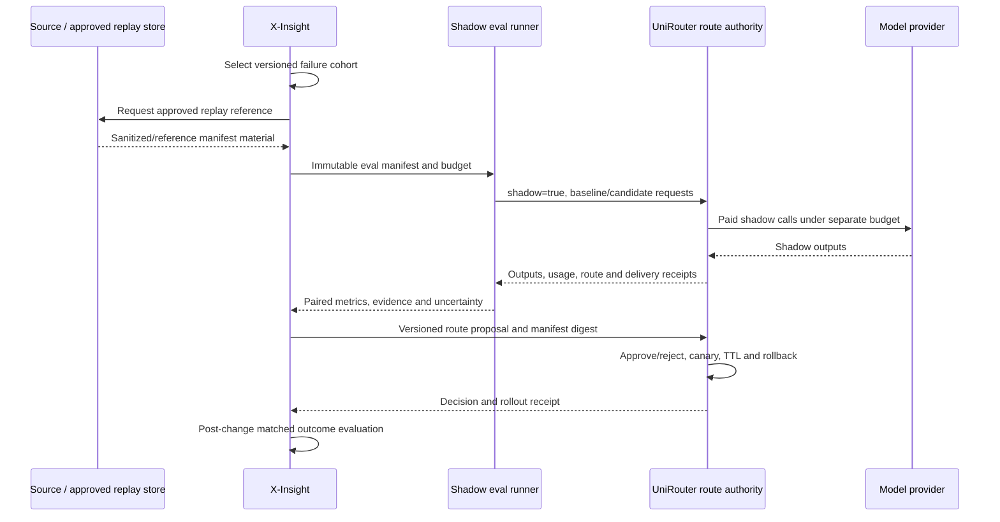

# Phase 2 X-Insight Innovation And Golden Boundary Matrix

Status: Golden Boundary defaults accepted 2026-07-13; innovation concepts remain
discussion inputs and are not accepted implementation scope
Date: 2026-07-13
Decision owner: User
Analysis owner: Codex
X-Insight analysis baseline: `b287874e544fa96ff0af9751ea6dda57d05e9cf6`
Decision update: B0-D19 through B0-D21 metadata/proposal/authority boundaries
accepted; semantic/privacy contracts, shadow budgets and activation transports
remain unresolved and unimplemented

## Answer First

X-Insight's defensible position is not “another trace UI,” “another prompt
firewall,” or a remote authorization service. It should become an
**evidence-to-control proof plane**: asynchronously combine cross-system
evidence, make uncertainty visible, run reproducible counterfactual analysis,
and return a bounded proposal to the system that actually owns the decision or
side effect.

The hard product boundary is:

> If a decision must change admission, routing, delivery or an irreversible
> side effect before that action completes, the final action owner must enforce
> it with bounded local work. If the answer needs history, joins, graph
> traversal, semantic models, counterfactuals or seconds-to-hours of compute,
> it belongs in X-Insight and is advisory until an action owner accepts it.

Under the current metadata-only, manual-sidecar posture:

- a structural Agent coordination graph and offline policy/model evaluation
  can be designed and tested with approved fixtures;
- complete “semantic anti-collusion” cannot be claimed without a later
  privacy-preserving semantic-evidence contract; and
- automatic shadow evaluation, route write-back or near-real-time analysis
  cannot be claimed without versioned transport, budget, replay and activation
  contracts.

The strongest killer-feature suite is:

1. **Coalition Lens** — gap-aware semantic/action/outcome coordination graph;
2. **Policy And Route Shadow Twin** — deterministic counterfactual policy plus
   governed model shadow evaluation;
3. **Policy Proof Chain** — finding to proposal, approval, rollout receipt and
   post-change effect evidence; and
4. **Authority Drift Radar** — effective delegation and blast-radius analysis
   with attenuation-only recommendations.

The first Phase 2 implementation slice remains execution search/timeline/
provenance/gaps. The Golden Boundary is accepted; the named killer-feature
implementations are follow-on decision inputs, not a reason to bypass the
accepted product foundation.

## Claim Discipline And Current Non-Capabilities

X-Insight currently imports normalized sanitized UniRouter evidence, persists
events/provenance/gaps and exposes request-ID read APIs. It does not currently
implement:

- a general DLP/PII classifier or content-redaction proxy;
- hallucination or truth blocking;
- provider invoice reconciliation or authoritative billing alignment;
- Agent/workflow/tool/resource lineage needed for a production coordination
  graph;
- an anti-collusion detector, graph store or semantic evaluator;
- online/shadow evaluation, model replay or route mutation;
- continuous/near-real-time external evidence transport;
- X-IAM, Tool Gateway, authenticated multi-user access or inline enforcement.

The current sensitive-key check rejects or quarantines unsafe imported source
material. It is a no-raw ingestion control, not a claim that X-Insight can
sanitize arbitrary production prompts and responses. Current schema or
source-type reservations are not adapters.

Stable UniRouter `main` has gateway-scoped Agent capability, usage/customer
accounting and sanitized snapshot support, but its general Guardrail Kernel is
not implemented there. Provider COGS/invoice reconciliation, claim assurance
and collusion detection are also not current capabilities. The ownership tables
below define where future capabilities should execute; they do not claim those
capabilities already exist.

## Four Quadrants

### Known Knowns

- Trace search, hierarchical span views, datasets, experiments, online
  scoring and inline single-interaction guardrails are already established
  product categories.
- X-Insight's accepted wedge is an operator investigation surface grounded in
  normalized evidence, provenance and capture gaps.
- Current evidence is metadata-only and arrives through an operator-mediated
  sidecar. X-Insight is not on the UniRouter hot path.
- The final model/tool/data action owner, not an analytics platform, must
  enforce admission and irreversible side effects.
- A graph drawn from timing or nesting is not automatically a causal or
  security graph. Every important edge needs source semantics, derivation and
  a gap/unknown state.

### Known Unknowns

- How much useful coordination risk can be detected from metadata and action
  receipts without content-derived semantic signals?
- What are acceptable false-positive, abstention and human-review rates for a
  “coordinated-deviation hypothesis”?
- Which approved replay reference can reproduce a production failure without
  X-Insight storing raw content?
- What quality/safety/cost/latency thresholds justify a route proposal, and who
  owns the shadow-call budget?
- Which policy/route system will own versioned canary, TTL and rollback?
- What 1x workload, retention period and end-to-end evidence-lag target should
  future near-real-time claims use?

### Unknown Knowns

- X-Insight's existing schema/importer
  direct/derived/declared/suppressed/gap/unknown model is more useful for
  audit-grade analysis than an attractive but inferred Agent flow diagram. The
  accepted UI presentation is not implemented yet.
- A low score is not enough to recommend routing. The trace's evidence quality,
  evaluator version, replay fidelity, paired outcome, cost and safety deltas
  must travel together.
- Legitimate multi-Agent collaboration naturally creates shared vocabulary,
  high communication density and coordinated actions. Language similarity
  alone is a poor collusion verdict.
- Current no-raw custody can become a differentiator if semantic computation
  happens at the source and X-Insight receives signed, versioned assertions
  rather than reusable content. A signature proves issuer and integrity, not
  semantic correctness.
- A feedback loop is auditable only if proposal, human/authority approval,
  deployed policy/route receipt and later effect evidence are distinct states.

### Unknown Unknowns

- Agents may learn covert channels in timing, tool arguments, shared resources
  or model quirks that the initial graph does not represent.
- A compromised source-side semantic detector may sign false assertions.
- Agents may adapt to known detector thresholds, manufacture gaps or split one
  harmful plan across tenants/sessions.
- A shadow winner may regress under changed traffic, tools, provider behavior
  or a later evaluator version.
- Policy and route feedback may create self-reinforcing selection bias: only
  traffic favored by the new route is observed after promotion.

These risks require explicit gaps, held-out evaluation, adversarial fixtures,
bounded rollouts, reversibility and human review. They cannot be eliminated by
calling a score “AI safety.”

## Boundary Golden Laws

### Hard Classification Rules

1. **Lifecycle override.** Anything that must allow/deny/modify a request or
   irreversible side effect before commit belongs to UniRouter or the final
   Tool/Data/Export PEP. X-Insight never owns that synchronous decision.
2. **Latency rule.** Hot-path decisions use locally available signed state and
   bounded checks. A remote X-IAM or X-Insight call is forbidden in the normal
   request path.
3. **Compute rule.** Exact schema, signature, scope, budget and small
   deterministic classifiers may be inline. LLM judging, graph closure,
   cross-run joins, clustering, counterfactual replay and unbounded retrieval
   are X-Insight/background work.
4. **Authority rule.** X-Insight can only narrow through a proposal. It cannot
   mint a capability, expand a grant, edit the billing ledger, activate a route
   or commit a tool action.
5. **Evidence rule.** Every derived risk/eval carries evidence references,
   algorithm/evaluator version, confidence or abstention, gaps and expiry.
6. **Failure rule.** Identity, tenant, audience, hard budget and final
   side-effect uncertainty fail closed. Optional analytics degrade with an
   explicit gap and cannot silently mean “safe.”

### Three-Dimension Decision Matrix

The numerical targets below are candidate design budgets, not measured current
SLOs.

| Latency tolerance | Compute shape | Call lifecycle | Owner | Interaction and hard rule |
| --- | --- | --- | --- | --- |
| Request-path, cached increment candidate `p99 <= 10 ms`; hard-state total increment candidate `p99 <= 25 ms` | Signature/scope/schema, exact allowlist, bounded `O(1)` lookup; bounded `O(depth)` only with a hard depth cap | Admission, model routing, budget reservation, output delivery | UniRouter PEP | Synchronous/local. No graph, LLM judge or remote X-IAM/X-Insight. |
| Before side-effect commit; bounded to the tool's action SLO | Subject/action/resource/context check, argument schema, egress rule, idempotency and approval state | Tool/data/export execution | Tool Gateway or final action-owner PEP | Synchronous. Fail closed if audience, resource version or approval is uncertain. |
| Off request path; per-domain revocation SLO from authority commit to every required PEP rejecting new admission | Policy compilation proportional to policy change, not action volume; tenant/audience shards with hard snapshot size | Identity lifecycle, grant/revoke, policy publication | Future X-IAM and upstream identity/policy authorities | Asynchronous publication; local PDP evaluates and sink PEP enforces. Current UniRouter `15 s` is only its Agent-capability root-cache fact, not a universal target. |
| Human-interactive read, normally hundreds of milliseconds to seconds | Indexed bounded search, keyset page, narrow projections | Investigation/search/timeline/detail | X-Insight query plane | Synchronous only to X-Insight's own UI/API; never blocks upstream action. |
| Seconds to minutes | Windowed joins, feature extraction, bounded graph motifs, calibrated semantic scoring | Post-action/near-real-time audit | X-Insight analysis plane | Asynchronous, tenant-budgeted, replayable and cancellable. Output is finding/advice. |
| Minutes to hours | Counterfactual replay, model/judge ensembles, experiments, full graph analysis | Evaluation, incident analysis, policy/route proposal | X-Insight evaluation plane | Asynchronous. Requires immutable manifest, budget and no-side-effect sandbox. |
| Seconds to hours | Durable state machine and human decision | High-impact approval | Approval/action owner, potentially coordinated by X-IAM | Async wait, but final PEP stays closed until an authenticated, unexpired, idempotent approval exists. |

Future latency evidence must report two separate intervals:

- source event to durable X-Insight import availability; and
- X-Insight arrival to finding availability.

Without a continuous transport contract, only the second interval can be
tested with fixture/replay input. Revocation latency similarly runs from
authoritative commit/publication through effective application at every
required PEP and must account for propagation, acknowledgment, clock skew and
offline nodes.

### Feature Ownership And Interaction Matrix

| Function | UniRouter / X-IAM / Tool PEP responsibility | X-Insight responsibility | Mechanism |
| --- | --- | --- | --- |
| Sensitive data protection | Policy authority defines classification; UniRouter must sanitize model ingress/egress when that future policy is accepted; Tool Gateway must sanitize tool arguments/results at the source/sink | Reject/quarantine unsafe evidence; show redaction declaration and capture gaps; analyze detector drift | Inline deterministic protection plus async evidence. Raw content remains out of X-Insight by default. |
| Hallucination/claim assurance | A future UniRouter guard enforces bounded schema/citation/format requirements for model delivery; action owner validates facts required before a real side effect | Offline/near-real-time groundedness, contradiction, abstention and evaluator calibration; investigate evidence coverage | Lightweight synchronous guard plus deep async evaluation. Never promise universal truth. |
| Token/cost alignment | UniRouter owns token normalization, price snapshot, customer ledger and settlement; provider cost/invoice domain owns COGS reconciliation | Read-only provenance/finality/drift/gap analysis; never mutate or override the ledger | Synchronous authoritative accounting plus async reconciliation analytics. |
| Single-call malicious content | UniRouter or Tool Gateway at the relevant ingress/egress | Aggregate detector behavior, false-positive and bypass trends | Synchronous decision receipt followed by async analysis. |
| Agent delegation and action authorization | Future X-IAM may federate identity/delegation inputs; action-owner-local PDP computes contextual authorization and the sink PEP enforces | Reconstruct historical delegation, evaluated versions and authority gaps | Local synchronous PDP/PEP, async evidence. |
| Multi-Agent suspicious coordination | Future X-IAM and the relevant current/future PEPs must preserve least privilege, separation of duties, budgets and final-action blocks | Cross-Agent/session/system temporal, semantic, policy and outcome graph; human-review case | Async/near-real-time only. |
| Shadow model evaluation | A future accepted UniRouter contract would expose an explicit `shadow` execution path, provider budget and sandbox boundary | Select failure cohorts, build manifest, run paired eval and produce a versioned route proposal | Async. Shadow output never reaches the client or real tool. |
| Route activation | UniRouter route authority validates proposal, approves, canaries, applies TTL/rollback and emits receipt | Track proposal, rollout receipt, outcomes and regression evidence | Operator-mediated/versioned by default; no direct X-Insight write. |
| Tool execution | The true sink/action owner contains the PEP. A Tool Gateway is one deployment form; the PEP obtains bounded credentials, validates an independent approval and controls egress/commit | Observe and analyze receipts | Synchronous at action owner; async to X-Insight. |

### Why The Four Ambiguous Functions Split This Way

- **Redaction:** the only component guaranteed to see data before disclosure is
  the source/egress owner. Sending raw content to X-Insight so X-Insight can
  redact it already crosses the boundary the redaction was meant to protect.
- **Hallucination:** some delivery requirements are exact and cheap, but deep
  factual assessment is probabilistic and expensive. Put exact guards at the
  delivery/action owner and evaluate semantic quality asynchronously.
- **Token billing:** accounting needs one authoritative ledger and exact
  settlement semantics. X-Insight is useful as an independent read-side
  auditor, but two writers would create financial split brain. If “smoothing”
  means converting provider volatility into a stable customer charge, that is
  a pricing/reserve/settlement policy owned by UniRouter or a future cost
  domain. X-Insight may simulate or flag drift, but cannot apply the charge.
- **Collusion:** in a heterogeneous deployment, one gateway often lacks the
  complete cross-Agent/session/tool history. Even where centralized telemetry
  exists, a request hot path is unsuitable for a cross-run graph and semantic
  judgment. X-Insight detects and explains; action owners enforce existing or
  approved new controls.

## Competitor And Research Baseline

This design is a synthesis, not a copied competitor roadmap. Official product
sources validate adjacent patterns; primary research supplies threat and
evaluation hypotheses. “Not found” below means not found in the reviewed
public material, not proof that a private product cannot do it.

| Source | Publicly documented strength used here | What is commodity / parity | X-Insight differentiation target |
| --- | --- | --- | --- |
| [LangSmith Evaluation](https://docs.langchain.com/langsmith/evaluation) | Offline/online evaluation and production-trace feedback into datasets | Production failure selection, scoring and eval workflows | Evidence/version/gap-bound policy and route proposal with rollout proof. |
| [Braintrust Online Scoring](https://www.braintrust.dev/docs/evaluate/score-online) | Background asynchronous scoring without application latency | Online scorers and log-to-dataset feedback | Paired no-side-effect model/policy diff with authority-owned activation receipt. |
| [Arize Phoenix](https://arize.com/docs/phoenix) | Open-source tracing, evaluators, datasets and experiments | Integrated trace/eval workspace | Cross-system governance evidence and authority/side-effect graph. |
| [Langfuse evaluation](https://langfuse.com/docs/evaluation/core-concepts) and [experiments](https://langfuse.com/docs/evaluation/experiments/experiments-via-ui) | Scores, datasets, experiments and production evaluation | Trace graph/eval UI and human review | Provenance/gap-aware findings and a verifiable control-change chain. |
| [Microsoft Purview DSPM](https://learn.microsoft.com/en-us/purview/data-security-posture-management-learn-about) | AI app/Agent activity, unusual access, sensitive-data governance, investigation, audited remediation and broader data posture | Enterprise AI/data activity, risk and remediation workflows | Runtime-neutral provenance/gap plus execution, authority and side-effect receipt linkage. |
| [Prisma AIRS](https://docs.paloaltonetworks.com/ai-runtime-security) | Inline/runtime prompt, response and tool scanning plus Agent/MCP protection, multi-Agent red teaming and privilege-misuse coverage | Runtime security and pre-production Agent testing | In the reviewed public material, a complete cross-runtime provenance/gap and action-outcome proof chain was not found. |
| [OWASP Multi-Agentic Threat Modeling Guide](https://genai.owasp.org/resource/multi-agentic-system-threat-modeling-guide-v1-0/) | Multi-Agent threat-model baseline | Threat taxonomy | Executable evidence model, detector abstention and remediation proof. |
| [NIST Agent Identity concept paper](https://www.nccoe.nist.gov/sites/default/files/2026-02/accelerating-the-adoption-of-software-and-ai-agent-identity-and-authorization-concept-paper.pdf) | Agent identity, authority, intent, audit and non-repudiation problem framing | Governance requirements | Product implementation that binds each finding to observed versions and evidence. |

Relevant research includes covert Agent communication in
[Whispering Agents](https://ojs.aaai.org/index.php/AAAI/article/view/40380),
multi-Agent collaboration topologies in
[MultiAgentBench](https://aclanthology.org/2025.acl-long.421/), collusion-audit
hypotheses in [Colosseum](https://arxiv.org/abs/2602.15198), adjacent
Agent-graph representation in [Agent-BOM](https://arxiv.org/abs/2605.06812),
and adversarial ML taxonomy in [NIST AI
100-2](https://www.nist.gov/publications/adversarial-machine-learning-taxonomy-and-terminology-attacks-and-mitigations-0).
Research results are not production detector proof.

## Innovation A — Coalition Lens / Semantic Anti-Collusion Graph

### Product Principle

The product should not label a group “colluding” because Agents share language
or communicate frequently. It should build an explainable, tenant-scoped
**coordinated-deviation hypothesis** from three separate layers:

1. communication or intent signals;
2. coordinated actions and authority movement; and
3. measurable policy/business impact.

High risk requires corroborating action/outcome evidence and an explainable
path. Language-only evidence is a review signal, never an automatic sanction.

### Privacy Modes

| Mode | Evidence available to X-Insight | Capability and claim | Gate |
| --- | --- | --- | --- |
| A0 — metadata structural graph | Agent/workflow IDs, delegation, policy decisions, model/tool/action/resource/outcome metadata, timestamps and gaps | Detect fanout, duty-splitting, budget/deny circumvention, unusual resource/action sequences. No complete semantic claim. | Compatible in principle with no-raw, but current contracts still lack the required lineage/tool fields. |
| A1 — source-local semantic assertion | Source computes facets/fingerprint/classifier result; sends content hash, detector digest, structured signals, calibration bucket and signature; raw is discarded locally | Adds paraphrase/coded-intent similarity without X-Insight raw custody. Signature proves issuer/integrity, not correctness. | New versioned evidence/privacy contract. Embeddings/fingerprints are sensitive and need classification, retention and membership-inference review. |
| A2 — governed content analysis | Tenant opt-in encrypted content or escrow samples with strict purpose, RBAC, retention/deletion, audit-on-read/export and regional controls | Deeper investigator replay and evaluator calibration | Explicit later User/tenant authorization; out of current Phase 2. |

### Heterogeneous Graph

Candidate nodes:

- human, workload, Agent definition, instance, workflow, invocation and child;
- capability, policy/version, approval and decision;
- model call, tool/action, resource/data class and outcome;
- semantic assertion, source, capture gap and incident/finding.

Candidate edges:

- declared delegation/parent, invoked, communicated, requested, allowed,
  denied, accessed, mutated and produced;
- derived temporal proximity, shared-resource, semantic similarity and
  counterfactual relation; and
- evidence-quality annotations or an `expected_but_unobserved_relation`
  record when a versioned rule expected a relationship but no supporting edge
  was captured. Missing evidence never creates an ordinary relationship edge.

Every node and edge carries tenant, source reference, provenance label,
observed/effective time, schema/algorithm version and expiry where applicable.
UI layout never becomes the fact source.

### Detection Pipeline

1. Build cheap candidates using bounded temporal motifs: denial followed by a
   different Agent attempting the same resource, authority split across
   children, circular delegation, unusual shared targets, correlated budget
   evasion or action sequences.
2. Compute structural and temporal features against role/workflow baselines.
3. If A1/A2 is approved, compare signed semantic facets while controlling for
   shared model, prompt template, team vocabulary and central planner effects.
4. Evaluate policy contradiction: did the coalition collectively produce an
   action or impact no individual path should have produced?
5. Run a bounded control/sensitivity analysis: matched benign workflows,
   removed edge/Agent hypotheses, alternate policy or expected action outcome.
   Observational removal is a counterfactual hypothesis, not causal proof.
6. Produce a finding with separate communication, coordinated-action and
   impact scores, an abstention reason, evidence path, gaps and recommended
   attenuation/human review.
7. A human or authoritative control plane may accept a narrowly scoped change.
   X-Insight never directly revokes or punishes a person/Agent.
8. Feed review disposition and later outcomes into calibration without
   rewriting historical evidence.



### Safety And Acceptance

| Test | Required evidence/invariant |
| --- | --- |
| Ground-truth fixtures | Benign collaboration, language-only, action-only, prompted coordination and gap-heavy cases across star/chain/tree/graph topologies. |
| Evidence class | A high-risk finding includes at least one directly observed action or policy contradiction. Any impact claim requires a measurable outcome. A matched control/counterfactual is required when evaluable; otherwise the detector abstains or narrows the claim. Exact counts, weights and P0/P1 mapping require calibration on an accepted labeled set. Language-only never creates an automatic P0 or sanction. |
| Provenance | Every feature/edge/result links to evidence refs and detector/model version; missing prerequisites produce `unknown`, `gap` or `not_evaluable`. |
| Bias/false positive | Report by team/model/workflow; shared model/template/planner baselines are explicit. Initial numeric precision/recall/FP thresholds require User acceptance and reviewed ground truth. |
| Privacy | A0 stores no raw. A1 assertion is signed, replay-protected and classified; its signature does not prove semantic correctness. A2 requires purpose, consent/authority, retention, deletion, audit and region controls. |
| Enforcement | Finding defaults to shadow/review. No automatic employment, legal, access or financial sanction. |
| Scale | Tenant-bounded windows, queue budgets, cancellable jobs and incremental projections; graph database is measurement-gated, not a prerequisite. |

## Innovation B — Shadow Eval-Back Loop

### Product Principle

X-Insight should turn a production failure into a reproducible evaluation and
then a **proposal**, not silently become the router. Automatic detection and
shadow execution may be allowed later; route activation stays with UniRouter
or the relevant action owner through versioned approval, canary, TTL and
rollback.

### No-Raw Replay Boundary

Current X-Insight cannot replay a raw production prompt because it does not
store one. A future evaluation manifest must use one of:

- a source-owned replay reference resolved inside the source trust boundary;
- an approved sanitized dataset/example derived from the failure; or
- a governed A2 escrow object under an explicit content contract.

The manifest records a hash/reference, not an invented reconstruction.

### Sequence

1. X-Insight selects a failure cohort from low score, explicit failure,
   capture gap or policy/outcome contradiction. Evaluator version and selection
   query are frozen.
2. Create an immutable `failure_to_eval_manifest` containing evidence refs,
   source snapshot/as-of, replay mode, baseline/candidate model and route
   versions, judge versions, tool sandbox policy, budget, approval and expiry.
3. An approved evaluation runner asks UniRouter for `shadow=true` calls under a
   separate tenant budget. Shadow outputs never reach the client. Tool/data
   effects are fake, read-only snapshots or denied.
4. Run paired baseline/candidate evaluation over quality, safety, task outcome,
   latency and total cost. Use held-out and adversarial sets, confidence
   intervals/abstention and evaluator calibration.
5. X-Insight emits a versioned `route_change_proposal` with cohort, evidence,
   manifest digest, deltas, uncertainty, proposed scope/TTL and rollback
   conditions. It does not edit a route table. Cryptographic signing is
   contract-gated on signer identity, key custody/rotation, trust roots,
   anti-replay and revocation semantics.
6. UniRouter's route authority rejects, approves or canaries the proposal and
   emits an immutable rollout/decision receipt.
7. X-Insight monitors matched post-change outcomes and guardrails. It records
   effect evidence, confounders and any rollback receipt.



### Failure And Abuse Controls

- Shadow calls have a separate hard budget, concurrency and provider quota.
- The manifest is idempotent; retries cannot multiply spend silently.
- A candidate model never receives broader data/tools than the baseline.
- External sends, writes, deletes, purchases and privilege changes are always
  denied/faked in shadow mode.
- An LLM judge is versioned and calibrated; its score alone cannot promote a
  route.
- A candidate must improve the accepted primary metric without violating
  safety, cost and latency guardrails. “Lower cost” cannot erase a safety
  regression.
- Automatic activation is not the default. It requires a later accepted
  threshold, authority, budget, canary, TTL, rollback and incident contract.
- X-Insight or eval-runner outage cannot alter the active route.

### Acceptance Matrix

| Test | Required evidence/invariant |
| --- | --- |
| Reproducibility | Manifest/input/configuration digests are deterministic. Deterministic Policy Twin runs require the same decision hash. Remote model/evaluator runs receive unique run hashes and are evaluated over accepted repetitions, confidence intervals and tolerance; provider revision drift creates `external_model_state_gap` rather than a strict reproducibility claim. |
| Side effects | All Tool/Data/Export calls are deny/fake/read-only snapshot; automated tests prove zero external mutation and zero client delivery. |
| Financial safety | Separate shadow ledger/budget, exact idempotency and provider usage receipts; no shadow charge becomes customer usage unless a later commercial contract explicitly says so. |
| Evaluation validity | Paired baseline/candidate, held-out and adversarial cohorts, calibrated judges and confidence/abstention. Missing replay facts produce `not_evaluable`. |
| Authority | Proposal and activation are separate records. Without a UniRouter rollout receipt, status remains `recommended`, never `implemented`. |
| Rollout | **Contract-gated/not applicable now.** A future UniRouter contract must own versioned canary, bounded exposure, TTL, safety rollback and a manual kill switch before promotion can be accepted. |
| Effect proof | Matched control or stepped rollout plus task-success/safety/cost/latency guardrails; pre/post correlation is not claimed as causation without confound analysis. |

## Additional Killer Features

### 1. Policy And Authority Digital Twin

Run the same event-derived facts through baseline and candidate
policy/capability logic with zero side effects. Return exact decision diffs,
policy digest, evidence refs and missing-fact reasons. Deterministic policy
replay can be valuable before continuous transport or model shadow spend.

**Differentiation hypothesis in reviewed public sources:** competitors commonly
score outputs; this makes the governance decision itself reproducible and
attributable. **Risk:** historical evidence
may omit hidden runtime state; a post-hoc pass is not proof the live request
would have behaved identically.

### 2. Policy Proof Chain

Persist the state machine:

```text
finding -> proposed control -> shadow diff -> human/authority approval
        -> rollout receipt -> later outcome evidence -> effectiveness finding
```

**Differentiation hypothesis in reviewed public sources:** closes the gap
between “dashboard insight” and an auditable, evidence-linked governance change
record. **Risk:** hashes prove record integrity, not source truth; outcome
change may be confounded by traffic/model/user changes.

### 3. Authority Drift And Blast-Radius Radar

Compare declared role/intent with effective audience-scoped capabilities,
delegation depth, dormant grants, resource reach and observed use. Simulate the
bounded over-approximation of reachable actions within the declared inventory
if an Agent/root is compromised, then propose attenuation, TTL reduction or
separation-of-duty changes. Coverage and unmodeled resources remain visible.

**Differentiation hypothesis in reviewed public sources:** joins
identity/delegation with actual execution evidence rather than showing an IAM
catalog alone. **Risk:** an incomplete action/resource inventory can still
understate blast radius despite over-approximation; the UI must show coverage
gaps and never call missing edges safe.

### 4. Evidence Completeness SLA / Unprovable Action Map

Treat missing mandatory facts as an operational product signal: which material
actions cannot be explained, under which source/schema/version, for how long,
and which investigations are not evaluable.

**Differentiation hypothesis in reviewed public sources:** makes observability
uncertainty auditable and blocks false confidence. **Risk:** gap storms can
become high-cardinality self-DDoS; aggregate bounded receipts and tenant budgets
are required.

## Feature Priority Matrix

| Band | Capability | Why this order | Dependencies and explicit exclusions |
| --- | --- | --- | --- |
| MVP / accepted Phase 2 first slice | Bounded execution search, cursor/error/input limits, timeline, selected-node/source/provenance/gap UI | Establishes the truthful evidence and operator workflow every later feature depends on | D01-D08 accepted; still not implemented. No graph, eval or feedback expansion. |
| Future innovation candidate / P2 | Policy/Authority Digital Twin over fixtures and sanitized event-derived facts | Recommended first innovation after the accepted product foundation; it is not part of the current Phase 2 MVP | Requires separate acceptance plus policy input/version contract; output advisory only. |
| Advanced candidate | Coalition Lens A0 structural graph plus evidence-quality rules | Builds graph semantics and false-positive discipline before semantic claims | Requires Agent/workflow/tool/action/resource receipts; post-hoc/shadow only. |
| Advanced candidate | Operator-mediated Policy Proof Chain | Creates verifiable proposal/approval/rollout/effect states without automatic write-back | Requires versioned proposal and manual rollout receipt contracts. |
| Advanced, contract-gated | Shadow Eval-Back Loop using approved replay references | Adjacent eval workflows are market-validated; the proof/authority chain is differentiating | Requires replay, budget, sandbox, evaluator, UniRouter shadow and rollout contracts; no auto activation. |
| Long-tail / research | Coalition Lens A1 signed semantic assertions | Enables semantic coordination analysis without central raw custody | Requires privacy classification, source detector, signatures, calibration, replay protection and retention. Signature proves source/integrity, not correctness. |
| Long-tail / explicit opt-in | A2 governed raw/escrow analysis and adaptive automated feedback | Highest semantic depth and automation | Raw custody, multi-tenant privacy, legal basis, RBAC, retention/deletion, regional, HA and incident controls; outside current posture. |

Do not prioritize a generic Agent graph, one more LLM-judge score, a universal
inline prompt firewall or automatic policy/route write-back. Those either lack
differentiation or violate the accepted boundary.

## P0–P3 Judgment

| Severity | Judgment |
| --- | --- |
| Current P0 | None. No new verified issue reopens Phase 1 under the current loopback, sanitized, manual-sidecar posture. |
| Conditional P0 before public/multi-tenant/Production or control feedback | Never place X-Insight/remote X-IAM in the hot path; source-local sanitization before raw leaves the source; complete mediation at final side effect; audience/epoch/revoke correctness; separate shadow budget; no X-Insight direct route/grant mutation. |
| P1 product foundation | After the remaining engineering contract freeze and an explicit implementation start, implement and verify the accepted D01-D08 investigation foundation; maintain no-raw, provenance/gap and real-versus-synthetic truth; decide the applicable B0-D09-D22 rows before expanding their dependent runtime boundaries. |
| P2 / separately accepted | Policy Twin, A0 graph, proof chain and operator-mediated shadow evaluation after their evidence/authority contracts. |
| P3 / research | Semantic collusion thresholds, A1/A2 content modes and any automatic feedback. Ground truth, false-positive/abstention thresholds and governance review are prerequisites. |

## Decisions Still Required

1. Accept or revise the Golden Laws and component ownership table.
2. Choose the first innovation wedge after the accepted UI foundation:
   Policy/Authority Digital Twin is recommended before semantic collusion or
   paid model shadowing.
3. Decide whether Tool Gateway is built, reused or deferred; it is required for
   authoritative tool-side-effect evidence but is not part of X-Insight.
4. Select semantic mode A0 only, A1 source-local assertions later, or whether
   A2 governed content should remain a permanent non-goal.
5. Name the owner and hard budget for shadow provider calls and approved replay
   data.
6. Accept that X-Insight outputs proposals only: UniRouter's route authority
   approves/activates/rolls back route proposals; the tenant policy authority
   approves policy proposals; the resource/action owner enforces only its own
   domain. No proposal grants authority by itself.
7. Define mandatory receipt classes and which high-impact actions fail closed
   if their receipt cannot be durably accepted by the action owner's local
   ledger/outbox; X-Insight delivery remains asynchronous.
8. Define ground truth and numeric precision/recall/false-positive/abstention
   gates before marketing “semantic anti-collusion.”

## Related Records

- [Phase 2 Batch 0 Scope And Decision Register](../planning/phase-2-batch-0-scope-and-decision-register-2026-07-13.md)
- [X-IAM, Tool Gateway And Cache Authority Boundary](../architecture/phase-2-xiam-tool-gateway-cache-authority-boundary-candidate-2026-07-13.md)
- [Competitive Alignment And Recommendation Rationale](phase-2-competitive-alignment-and-recommendation-rationale-2026-07-13.md)
- [Three-Product Scalability Anti-Pattern Audit](unirouter-x-iam-x-insight-scalability-antipattern-audit-2026-07-13.md)
- [Phase 2 Product Priority](../planning/phase-2-product-priority.md)
