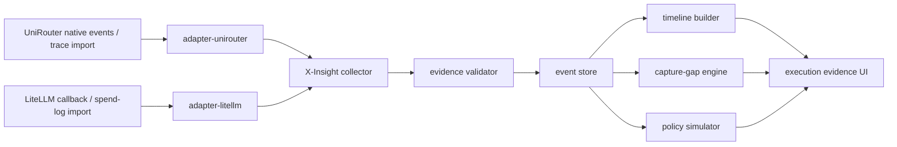

# PRD1 Dual Demo Definition

Status: demo definition, not PRD
Created: 2026-07-08

## Purpose

This document defines the first two X-Insight demos before writing PRD1.

The purpose is not to produce a marketing scenario. The purpose is to test whether X-Insight can become an AI Execution Evidence / Governance Plane instead of another AI gateway observability dashboard.

The demo definition should force four product and architecture questions into concrete form:

1. Can X-Insight turn gateway and runtime activity into a human-readable execution evidence chain?
2. Can X-Insight ingest from both a controlled first-party gateway and a mainstream third-party gateway without changing the core evidence model?
3. Can X-Insight explicitly show what is directly observed, what is derived, and what remains a capture gap?
4. Can X-Insight support lightweight historical policy simulation without pretending to be a full enforcement product in PRD1?

## Core Demo Thesis

PRD1 should use a dual-demo strategy:

| Demo | Role | Source | Fidelity goal | Strategic purpose |
| --- | --- | --- | --- | --- |
| Demo A | Deep reference demo | UniRouter | F3 target | Prove the product can create a high-fidelity evidence chain when the source can be instrumented deeply. |
| Demo B | Ecosystem compatibility demo | LiteLLM | F2 target | Prove the product is not a UniRouter plugin and can ingest from a recognized external gateway. |

These two demos must converge into the same X-Insight UI and evidence contract.

If the UniRouter demo needs a separate product model from the LiteLLM demo, the architecture is wrong.

If the LiteLLM demo can only show a generic trace dashboard, the differentiation is too weak.

If either demo hides capture gaps, the product is overclaiming.

## What The Demos Must Prove

### Product Proof

The demos must prove that X-Insight can answer these questions for a human operator:

- Who or what initiated this AI execution?
- Which gateway, key, project, team, or owner was involved?
- Which model or capability was requested?
- Which model/provider/channel was actually used?
- What decisions happened along the way?
- What was the outcome, cost, latency, and usage?
- Which evidence supports each claim?
- Which parts are missing, unobservable, or only inferred?
- What would a proposed policy have flagged if it had existed?

The key human experience is not "I can see a trace."

The key human experience is:

> I can understand the execution chain, inspect evidence at each node, and see exactly where the organization's visibility ends.

### Architecture Proof

The demos must prove that X-Insight has the right architecture boundaries:

- source adapters map into a common evidence event model;
- evidence events preserve source identity and source version;
- direct, derived, and gap states are first-class;
- raw payload storage is not required;
- policy simulation reads historical evidence rather than blocking live traffic;
- the same timeline/evidence UI can render different fidelity levels honestly.

### Market Proof

The demos must send two different market signals:

- UniRouter signal: X-Insight can go deep when the enterprise controls the gateway.
- LiteLLM signal: X-Insight is gateway-neutral and useful to teams already using mainstream open-source gateway infrastructure.

The combined signal should be:

> X-Insight is not a gateway replacement. It is an execution evidence and governance layer that works across gateways with explicit fidelity levels.

## Non-Goals

The dual demo should not include:

- broad synchronous enforcement;
- a full policy authoring system;
- full OTel backend scope;
- ontology-first business modeling;
- default prompt/response storage;
- production-grade SIEM integration;
- automatic discovery of all downstream agent side effects;
- complete MCP/tool governance;
- one-api/new-api demo parity.

These are not unimportant. They are excluded because PRD1 should first prove the evidence model and adapter boundary.

## Demo A: UniRouter Deep Evidence Demo

### Position

UniRouter is the deep reference integration.

This demo should show what X-Insight can do when the source system can be changed to emit high-fidelity governance evidence.

It should not be positioned publicly as "X-Insight for UniRouter." It should be positioned as:

> Reference high-fidelity gateway integration.

### Target User

Primary daily operator:

- AI platform owner;
- enterprise IT operator responsible for internal AI gateway usage;
- platform engineer responsible for model routing, cost, reliability, and usage accountability.

Stakeholders:

- CISO/security governance;
- compliance/audit;
- business owner of the consuming application;
- finance/procurement for cost attribution.

### Demo Scenario

A user or service calls an enterprise AI gateway through UniRouter.

UniRouter authenticates the key, maps project/org/user context, resolves the requested model, selects route/provider/channel, runs billing precheck/freeze, calls the provider, parses usage, settles billing, writes call logs/audit logs, and emits trace/evidence events.

X-Insight ingests those events and shows a single execution evidence timeline.

The operator can click each node and see:

- what happened;
- who/what the event is attributed to;
- which source record proves it;
- whether the claim is direct or derived;
- which evidence is missing;
- what a policy simulation would have flagged.

### Minimum Timeline Nodes

The demo should show at least these nodes when data is available:

| Timeline node | Source | Evidence strength | Notes |
| --- | --- | --- | --- |
| Request accepted | UniRouter trace event | Direct | Includes `request_id`, project/org/key context. |
| Identity resolved | UniRouter context/call log | Direct or derived | Should show actor/key/owner. |
| Budget precheck/freeze | UniRouter billing event | Direct | Should become an explicit decision record when UniRouter adds decision fields. |
| Model resolved | UniRouter routing data | Direct | Requested model versus resolved model. |
| Route selected | UniRouter routing event | Direct | Provider/channel/route metadata. |
| Provider request attempted | UniRouter provider event | Direct | Does not require raw prompt. |
| Provider response accepted/rejected | UniRouter provider event | Direct | Status, latency, error class if present. |
| Usage parsed | UniRouter usage/call log | Direct or derived | Token usage, source, confidence. |
| Billing settled/cancelled | UniRouter billing event | Direct | Cost and settlement result. |
| Call log recorded | UniRouter logging event | Direct | Source reference for later audit. |
| Capture gaps generated | X-Insight adapter | Derived | Missing business outcome, downstream tool effects, raw payload disabled. |
| Policy simulation result | X-Insight simulation | Derived | Historical evaluation only. |

### Required UniRouter Evidence Enhancements

UniRouter can already provide a strong baseline through `request_trace_events`, call logs, audit logs, and privacy-aligned metadata.

For the demo to prove X-Insight's differentiated architecture, UniRouter should add or expose these structural fields before or during PRD1:

- `trace_id`
- `span_id`
- `parent_span_id`
- `schema_version`
- `source_component`
- `capture_mode`
- `capture_gap`
- `evidence_ref`
- `source_event_hash`
- `decision_kind`
- `decision_result`
- `decision_reason`
- `actor_type`
- `actor_ref`
- `owner_ref`

These are not cosmetic fields.

They determine whether X-Insight can show a believable evidence chain instead of a sequence of gateway logs.

### UniRouter Demo UI Requirements

The first screen should not be a generic log table.

Recommended first screen:

- left: execution timeline;
- center or right: selected node details;
- top strip: actor, project, model, provider, cost, status, evidence quality;
- side panel: capture gaps and policy simulation.

Each node should show:

- title;
- timestamp;
- source system;
- evidence strength: direct, derived, or gap;
- severity/outcome;
- clickable source reference;
- field-level details.

The UI must be able to show:

- direct event;
- derived event;
- missing evidence;
- privacy-disabled payload;
- unknown downstream side effect.

This matters more than a visually complex graph.

### UniRouter Demo Success Criteria

The UniRouter demo succeeds if:

- a real or controlled UniRouter request produces a timeline without hand-authored demo data;
- the timeline contains direct source references for key events;
- the operator can inspect identity, routing, billing, provider, usage, and logging evidence;
- at least three capture gaps are visible and understandable;
- no prompt/response plaintext is required;
- policy simulation can evaluate at least two simple historical rules;
- the same normalized evidence model can be used by the LiteLLM demo.

Suggested simulation rules:

- flag requests using non-approved model groups;
- flag requests with missing project/owner attribution;
- flag requests above a cost threshold;
- flag requests routed to a provider/channel outside an allowed list;
- flag executions with unknown downstream business outcome.

## Demo B: LiteLLM Compatibility Demo

### Position

LiteLLM is the first external credibility adapter.

This demo should prove that X-Insight can work with existing gateway ecosystems without requiring users to adopt UniRouter.

It should be positioned as:

> Mainstream gateway compatibility with explicit evidence fidelity.

### Target User

Primary daily operator:

- AI platform owner already running LiteLLM;
- platform engineer managing teams, virtual keys, model groups, budgets, and usage;
- IT owner looking for governance evidence without replacing the gateway.

Stakeholders:

- security governance;
- finance/cost owner;
- engineering managers responsible for AI app usage.

### Demo Scenario

A LiteLLM request is observed through one or both paths:

- historical spend-log import from `LiteLLM_SpendLogs`;
- real-time callback to an X-Insight ingestion endpoint.

X-Insight maps the LiteLLM event into the same evidence model used by the UniRouter demo.

The operator sees:

- request identity and attribution where available;
- model/provider/call type;
- team/org/user/end-user context;
- token usage, spend, latency, cache, and status;
- session/agent/MCP-adjacent fields if present;
- explicit capture gaps for missing decisions, business outcome, and downstream tool execution.

### Minimum Timeline Nodes

The LiteLLM demo should show fewer nodes than UniRouter, because the evidence fidelity is lower.

That is acceptable if the UI is honest.

| Timeline node | Source | Evidence strength | Notes |
| --- | --- | --- | --- |
| LiteLLM request observed | callback or spend log | Direct | Uses `request_id`. |
| Identity/context mapped | spend log / metadata | Direct or optional | User, team, org, end user, API key hash. |
| Model invocation | spend log / callback | Direct | Model, model group, provider, API base. |
| Usage and cost recorded | spend log | Direct | Tokens, spend, duration. |
| Session or agent link | spend log / metadata | Optional direct | `session_id`, `agent_id`, MCP tool name if present. |
| Payload policy applied | adapter | Derived | No default prompt/response import. |
| Capture gaps generated | X-Insight adapter | Derived | Missing routing decision, policy decision, business side effects. |
| Policy simulation result | X-Insight simulation | Derived | Historical evaluation only. |

### Required LiteLLM Adapter Capabilities

The first real LiteLLM adapter should include:

- spend-log import with cursor/backfill;
- real callback ingestion endpoint;
- adapter manifest with source version and field support;
- mapping from LiteLLM metadata to X-Insight correlation fields;
- payload exclusion by default;
- capture-gap generation;
- fixtures from a real LiteLLM request;
- conformance tests for direct/derived/gap labeling.

The adapter should not require:

- replacing LiteLLM;
- enabling prompt/response storage;
- deploying UniRouter;
- full OTel backend support.

### LiteLLM Demo UI Requirements

The LiteLLM demo should use the same UI structure as the UniRouter demo, but show different evidence quality.

It should be visually obvious that:

- some fields are direct;
- some fields are optional or metadata-dependent;
- routing/billing decisions may not be visible with the same strength as UniRouter;
- downstream side effects remain capture gaps unless instrumented elsewhere.

This is important. If the UI makes LiteLLM look as complete as UniRouter, X-Insight is lying. If the UI makes LiteLLM look useless, the product loses ecosystem credibility.

The right message is:

> Existing gateways can provide useful execution evidence, but fidelity differs. X-Insight makes that difference visible and governable.

### LiteLLM Demo Success Criteria

The LiteLLM demo succeeds if:

- X-Insight ingests at least one real LiteLLM request through callback or spend-log import;
- the request renders in the same evidence timeline UI as UniRouter;
- spend, tokens, model, provider/model group, duration, and user/team context are visible where present;
- prompt/response storage is disabled by default;
- capture gaps are shown for missing decision/business/tool evidence;
- adapter manifest labels LiteLLM as F1/F2, not F3;
- the demo can run without UniRouter.

## Shared Demo Architecture

The two demos should share the same X-Insight core:

Shared components:

- collector;
- evidence validator;
- adapter manifests;
- event store;
- timeline builder;
- capture-gap engine;
- policy simulation engine;
- evidence UI.

Source-specific components:

- `adapter-unirouter`;
- `adapter-litellm`;
- source-specific import/callback handlers;
- source-specific conformance fixtures.

The architecture should make it difficult for adapters to bypass the evidence model.

## Shared Event Flow

Every demo event should pass through the same flow:

1. Source event is received.
2. Adapter maps source fields to X-Insight evidence event.
3. Adapter labels fields as direct, derived, optional, or gap.
4. Validator checks required envelope fields.
5. Collector stores event with source reference and adapter version.
6. Timeline builder creates human-readable execution chain.
7. Capture-gap engine creates visible missing-evidence nodes.
8. Policy simulator evaluates historical rules.
9. UI shows timeline, details, evidence references, gaps, and simulation results.

This flow is the product's early control point.

The adapters should be thin, but strict.

## Shared Evidence Quality Model

The UI and data model should support at least these evidence labels:

| Label | Meaning | Example |
| --- | --- | --- |
| Direct | Source observed and emitted the fact. | UniRouter provider response status. |
| Derived | X-Insight inferred or normalized the fact. | A standardized `capability_invocation` built from LiteLLM spend fields. |
| Optional | Fact may be present only if the source/customer configured it. | LiteLLM `session_id` or metadata trace ID. |
| Gap | Fact is missing and affects a claim humans might otherwise assume. | Downstream database write after model response. |
| Suppressed | Fact may exist but was intentionally not stored for privacy. | Prompt/response plaintext disabled. |

This model is more important than a full graph in PRD1.

## Minimal Demo Policy Simulation

Policy simulation should be deliberately lightweight.

It should answer:

> If this proposed policy had been active, which historical executions would have been flagged?

It should not:

- block live traffic;
- require OPA/Rego in the first demo;
- become a full policy authoring product;
- require side-effect visibility that does not exist.

Suggested first policy simulation fields:

- actor/project/team;
- requested model;
- resolved model/model group;
- provider/channel;
- cost/spend;
- token count;
- missing owner/project;
- capture gap type;
- payload capture state;
- time window.

Suggested first policy simulation outputs:

- matched/not matched;
- rule reason;
- affected requests;
- evidence fields used;
- missing evidence that limits confidence.

This simulation is a wedge into governance. It is not enforcement yet.

## Minimal Demo Data Model Implications

The dual demo implies the next document, `PRD1 Minimal Data Model`, should include at least:

- source registry;
- adapter manifest;
- evidence event;
- evidence field provenance;
- execution correlation;
- identity context;
- capability invocation;
- decision record;
- usage/cost;
- evidence reference;
- payload policy;
- capture gap;
- policy simulation result.

The data model should avoid one early mistake:

Do not store one giant trace row that tries to contain everything.

Use event-like records with source references, then derive timelines and evidence packs from them.

## Demo Boundary Decisions

### Decision 1: Timeline First, Full Graph Later

Recommendation:

Use a timeline/evidence-chain UI first, not a complex graph UI.

Why:

- current gateway evidence is request-centric;
- full graph implies multi-span causal certainty that not all sources provide;
- timeline is easier for enterprise IT and AI platform owners to inspect;
- graph can be added once trace/span/tool/business events exist.

The timeline can still be visually rich. It should not look like a raw log table.

### Decision 2: Capture Gaps Are Visible Product Objects

Recommendation:

Capture gaps should appear as first-class nodes or side-panel items.

Why:

- gateway-only capture cannot see all agent side effects;
- hiding this would destroy trust;
- making it visible turns a technical limitation into governance value;
- it creates a roadmap for SDK/MCP/OTel/business-system adapters.

### Decision 3: Payloads Are Governed, Not Required For The Demo

Recommendation:

Do not store prompt/response plaintext by default. Allow on-prem enterprises to enable prompt/response capture only through governed payload policy.

Why:

- the first product proof is execution evidence, not content replay;
- payload storage creates procurement, privacy, retention, and audit obligations;
- payload references and redacted metadata are enough for PRD1 demo;
- on-prem opt-in storage should be modeled now, but raw content capture does not need to be active in the first demo.

The switch should not be a single boolean. It should include scope, capture mode, redaction, retention, encryption, RBAC, audit-on-read, export/delete controls, and legal hold behavior.

### Decision 4: LiteLLM Is Real, But Not Mandatory

Recommendation:

Maintain a runnable LiteLLM demo/test stack, but do not require users to deploy LiteLLM.

Why:

- public credibility needs a recognized external gateway;
- customers should connect their existing gateway;
- forcing LiteLLM would turn X-Insight into an ecosystem add-on;
- UniRouter remains the fastest deep build path.

### Decision 5: OTel/OpenInference Is Reserved, Not Central

Recommendation:

Reserve OTel/OpenInference ingestion/export in architecture and schema, but do not make the first demo depend on full OTel backend scope.

Why:

- standards alignment matters for ecosystem trust;
- full OTel backend scope can distract from governance evidence;
- OTel spans alone do not guarantee identity, decisions, or business intent;
- the adapter model should allow OTel/OpenInference to become a major path later.

## Risks And How The Demo Should Expose Them

| Risk | How the demo should expose it | Why this is useful |
| --- | --- | --- |
| UniRouter plugin perception | LiteLLM demo runs through the same UI without UniRouter. | Shows gateway neutrality. |
| Generic observability perception | UI emphasizes evidence, decisions, identity, gaps, and policy simulation. | Separates X-Insight from trace dashboards. |
| Overclaiming agent visibility | Capture gaps explicitly show unobserved side effects. | Builds trust with enterprise buyers. |
| Payload privacy objections | Demo works without prompt/response storage. | Reduces adoption friction. |
| Adapter sprawl | Adapter manifest and fidelity labels are required. | Prevents false compatibility claims. |
| Premature enforcement | Simulation is historical and explainable. | Keeps PRD1 buildable. |

## What This Means For PRD1

PRD1 should probably not be framed as:

> Build an AI observability dashboard.

It should be framed closer to:

> Build the first runnable X-Insight evidence plane that ingests UniRouter and LiteLLM execution evidence, renders a human-readable execution timeline with direct/derived/gap labels, and supports lightweight historical policy simulation without storing raw prompts or responses by default.

This is narrower than the full vision, but it preserves the strategic direction.

## Open Questions After This Document

These questions should be answered while writing `PRD1 Minimal Data Model`:

1. Should X-Insight's first event store be only Postgres, or Postgres with an explicit future ClickHouse event sink boundary?
2. Should `evidence_ref` be a simple source pointer first, or should PRD1 include event hashing?
3. Should `decision_record` be a separate object or an event subtype?
4. How should field-level provenance be stored without overcomplicating v1?
5. How much of the UniRouter F3 field set should be added before the first running demo versus after the first ingestion loop?
6. Should the LiteLLM demo prioritize callback ingestion or spend-log import first if only one can be implemented initially?

Current recommendation:

- Postgres first, with event-store boundaries that allow ClickHouse later.
- `evidence_ref` plus optional event hash first; signed chains later.
- decision as an event subtype first, separable later if policy simulation grows.
- field provenance at field-group level first, not every scalar field.
- UniRouter should add structural fields early, especially trace/span/capture/decision/evidence refs.
- LiteLLM callback should prove real-time compatibility, spend-log import should prove historical adoption; if forced to choose one first, build callback first and import immediately after.
