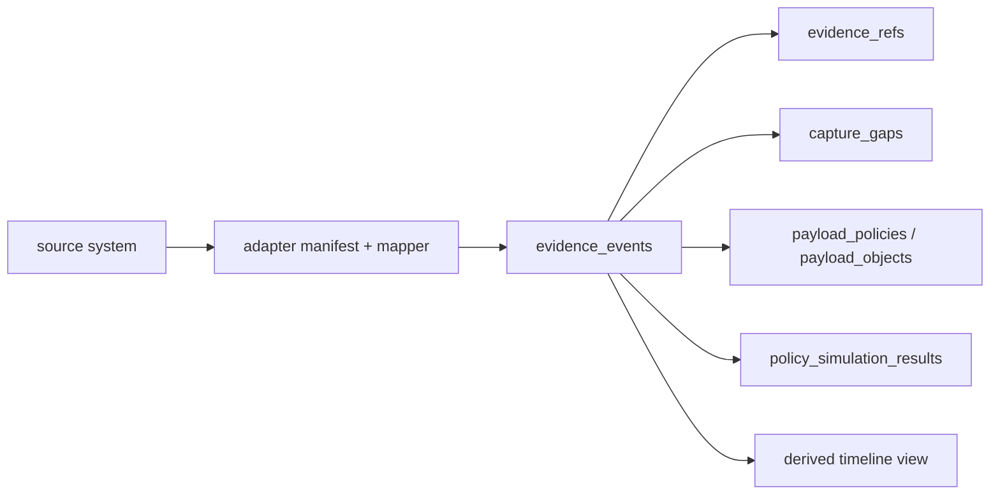

# PRD1 Minimal Data Model

Status: pre-PRD data model, not implementation spec
Created: 2026-07-08

## Purpose

This document defines the minimum data model implied by:

- `Evidence Contract v0.1 Working Draft`;
- `Gateway Adapter Mapping Matrix v0.1`;
- `PRD1 Dual Demo Definition`.

The goal is to make PRD1 buildable without collapsing the product into one of three traps:

- a gateway-specific log viewer;
- a generic trace dashboard;
- an overbuilt governance platform with too many abstractions before there is evidence.

The minimum model should support:

- UniRouter deep evidence demo;
- LiteLLM compatibility demo;
- direct / derived / gap labeling;
- human-readable execution timeline;
- evidence references;
- optional governed prompt/response capture;
- lightweight historical policy simulation;
- future adapters for new-api, one-api, OTel/OpenInference, MCP, SDKs, and business systems.

## Core Judgment

PRD1 should use an event-first model with strict source provenance.

It should not use:

- one giant trace row;
- one gateway's log schema as the product schema;
- raw prompt/response as the primary evidence object;
- a full enterprise ontology as the foundation.

Recommended shape:



The event store is the source of record. Timelines, evidence packs, dashboards, and policy simulation views are derived from it.

## Storage Strategy

### PRD1 Recommendation

Use Postgres first.

Why:

- PRD1 needs correctness, RBAC, joins, source references, retention metadata, audit reads, adapter manifests, and flexible JSONB more than billion-row analytics.
- UniRouter and LiteLLM demos are not enough volume to justify ClickHouse as the first required dependency.
- Postgres keeps on-prem deployment simpler.
- JSONB allows source-specific fields without schema churn.

But the schema must reserve an analytics sink boundary:

- append-only event IDs;
- stable event envelope;
- `occurred_at`, `observed_at`, `ingested_at`;
- source version and adapter version;
- partitionable time fields;
- no reliance on cross-row mutation for normal event ingestion.

ClickHouse can be introduced later when customers need:

- high-volume historical analytics;
- long-retention event search;
- high-cardinality dashboards;
- cost/usage aggregates over very large data;
- SIEM-scale export workloads.

This should be an architecture boundary, not a PRD1 dependency.

## Object Model Overview

PRD1 needs the following objects:

| Object | Required in PRD1 | Role |
| --- | --- | --- |
| Source System | Yes | Describes UniRouter, LiteLLM, new-api, one-api, OTel, SDK, MCP, or business systems. |
| Adapter Manifest | Yes | Declares adapter version, source compatibility, fidelity, fields, privacy behavior, and gaps. |
| Evidence Event | Yes | Append-only normalized event envelope. |
| Evidence Field Provenance | Yes, field-group level | Records whether claims are direct, derived, optional, suppressed, or gaps. |
| Execution Correlation | Yes | Links requests, traces, spans, sessions, runs, and parent/child relationships. |
| Identity Context | Yes | Captures actor, owner, key, org, project, team, end-user, and on-behalf-of where available. |
| Capability Invocation | Yes | Captures model/tool/API/data capability used or requested. |
| Decision Record | Yes, as event subtype first | Captures routing, billing, access, policy, or provider decisions when available. |
| Usage/Cost Record | Yes | Captures tokens, spend, latency, usage source, and confidence. |
| Evidence Reference | Yes | Points to source rows, trace IDs, payload refs, files, object storage, or external systems. |
| Payload Policy | Yes | Records prompt/response/tool-result capture mode and controls. |
| Payload Object | Optional but modeled | Stores or references captured payloads when explicitly enabled. |
| Capture Gap | Yes | Makes missing or unobservable evidence explicit. |
| Policy Simulation | Yes, lightweight | Stores historical rule evaluations and evidence fields used. |
| Timeline Node | Derived, optional materialized view | Human-readable execution chain built from events. |
| Audit Read Event | Yes if payload read exists | Records who accessed sensitive evidence and why. |

## Source System

Purpose:

Represent the origin of evidence before adapter normalization.

Minimum fields:

| Field | Type | Notes |
| --- | --- | --- |
| `id` | UUID | Internal source ID. |
| `source_system` | string | `unirouter`, `litellm`, `new-api`, `one-api`, `otel`, `openinference`, `sdk`, `mcp`, `business_system`. |
| `display_name` | string | Human-readable name. |
| `source_version` | string | Version or commit where known. |
| `deployment_ref` | string | Optional customer/environment reference. |
| `owner_ref` | string | Internal owner or admin group. |
| `created_at` | timestamp | Registration time. |
| `status` | enum | `active`, `disabled`, `degraded`, `archived`. |

Why:

X-Insight cannot treat all evidence as if it came from one trusted source. The source system is part of the evidence.

## Adapter Manifest

Purpose:

Prevent false compatibility claims.

Minimum fields:

| Field | Type | Notes |
| --- | --- | --- |
| `id` | UUID | Manifest ID. |
| `adapter_id` | string | Example: `adapter-unirouter`, `adapter-litellm`. |
| `adapter_version` | string | Version of mapper. |
| `source_system` | string | Source this adapter supports. |
| `validated_source_version` | string | Exact version/commit tested. |
| `integration_modes` | string[] | `native_event`, `callback`, `db_import`, `api_import`, `otel`, `sdk`. |
| `fidelity_level` | enum | `F0`, `F1`, `F2`, `F3`. |
| `supports_backfill` | boolean | Historical import. |
| `supports_realtime` | boolean | Callback/native event. |
| `supports_trace_span` | boolean | Trace/span correlation. |
| `supports_upstream_request_id` | boolean | Upstream correlation. |
| `supports_decision_records` | boolean | Native or mapped decisions. |
| `supports_payload_references` | boolean | Payload references without raw storage. |
| `stores_prompt` | boolean | Whether adapter can store prompt payload. |
| `stores_response` | boolean | Whether adapter can store response payload. |
| `direct_fields` | JSONB | Source-observed fields. |
| `derived_fields` | JSONB | Fields inferred or normalized by adapter. |
| `known_capture_gaps` | JSONB | Known missing evidence. |
| `privacy_notes` | text | Important handling caveats. |

Why:

Adapter fidelity is a product concept, not internal metadata. Customers need to know what support actually means.

## Evidence Event

Purpose:

Append-only normalized record of what happened or what was observed.

Implementation note:

- The narrowed PRD1 M0 field contract is maintained in [PRD1 M0 Evidence Envelope Candidate](./prd1-m0-evidence-envelope-candidate.md). If field-level details differ, use the M0 envelope candidate for implementation planning.

Minimum fields:

| Field | Type | Notes |
| --- | --- | --- |
| `id` | UUID | X-Insight event ID. |
| `schema_version` | string | Evidence schema version. |
| `source_system_id` | UUID | Links source. |
| `adapter_manifest_id` | UUID | Links mapper/version. |
| `source_event_id` | string | Source-side event/row/callback ID when available. |
| `source_ref` | string | Stable pointer to source record. |
| `event_type` | string | Normalized event type. |
| `stage` | string | `gateway`, `routing`, `provider`, `billing`, `usage`, `policy`, `payload`, `gap`, etc. |
| `severity` | enum | `info`, `warning`, `error`. |
| `confidence` | enum | `high`, `medium`, `low`, `unknown`. |
| `capture_mode` | enum | `native`, `callback`, `db_import`, `api_import`, `otel`, `sdk`, `mcp`, `derived`. |
| `occurred_at` | timestamp | Source event time. |
| `observed_at` | timestamp | Time source observed it. |
| `ingested_at` | timestamp | X-Insight ingestion time. |
| `correlation` | JSONB | Request/trace/span/session/run IDs. |
| `identity` | JSONB | Actor/org/project/key/team context. |
| `capability` | JSONB | Model/tool/API/data capability context. |
| `decision` | JSONB | Decision fields if event is decision-related. |
| `usage` | JSONB | Usage/cost/latency fields. |
| `outcome` | JSONB | Status/result/error. |
| `payload_policy` | JSONB | Payload capture state for this event. |
| `field_provenance` | JSONB | Direct/derived/gap/suppressed labels at field-group level. |
| `raw_source_excerpt` | JSONB | Small allowlisted source metadata only, not payload. |
| `event_hash` | string | X-Insight-generated hash of canonical normalized event body for M0 duplicate-conflict handling. |

Why JSONB:

PRD1 needs to ingest heterogeneous evidence without a migration every time an adapter adds a field. JSONB should be used inside a disciplined envelope, not as an excuse for ungoverned blobs.

## Execution Correlation

Purpose:

Support request timeline now and multi-step execution graph later.

Minimum fields inside `evidence_events.correlation`:

| Field | Required | Notes |
| --- | --- | --- |
| `request_id` | Yes when source has it | UniRouter, LiteLLM, new-api, one-api all have request-level IDs. |
| `upstream_request_id` | Optional | Strong in new-api; useful for provider correlation. |
| `trace_id` | Optional, reserved | Required for full execution graph later. |
| `span_id` | Optional, reserved | Required for full execution graph later. |
| `parent_span_id` | Optional, reserved | Required for parent/child chain later. |
| `session_id` | Optional | Useful for LiteLLM and agent runs. |
| `run_id` | Optional | Future SDK/MCP/business workflow runs. |
| `parent_event_id` | Optional | Event-level chain when span is missing. |

Recommendation:

PRD1 should require `request_id` when available and reserve trace/span fields from day one. It should not force every source into OTel semantics.

## Identity Context

Purpose:

Prevent anonymous traces.

Minimum fields inside `evidence_events.identity`:

| Field | Required | Notes |
| --- | --- | --- |
| `actor_type` | Yes | `human`, `service`, `agent`, `sub_agent`, `unknown`. |
| `actor_ref` | Yes when available | User ID, service key, agent ID, end-user ID. |
| `owner_ref` | Optional | Business or platform owner. |
| `org_ref` | Optional | Organization/tenant. |
| `project_ref` | Optional | Project/workspace/application. |
| `team_ref` | Optional | LiteLLM team or enterprise team. |
| `api_key_ref` | Optional | Hashed or internal key reference only. |
| `end_user_ref` | Optional | End-user/customer context. |
| `on_behalf_of` | Optional | Delegation chain. |
| `identity_confidence` | Yes | `direct`, `derived`, `unknown`. |

Judgment:

Identity should be first-class even when incomplete. Missing identity is a capture gap, not an empty column.

## Capability Invocation

Purpose:

Normalize model calls today and tool/API/data capability calls later.

Minimum fields inside `evidence_events.capability`:

| Field | Required | Notes |
| --- | --- | --- |
| `capability_type` | Yes | `model`, `tool`, `api`, `data_source`, `retrieval`, `workflow`, `unknown`. |
| `capability_name` | Yes when available | Model name, tool name, API name. |
| `requested_model` | Optional | Requested by caller. |
| `resolved_model` | Optional | Actual model used. |
| `provider` | Optional | Provider or upstream system. |
| `channel` | Optional | Gateway/provider channel. |
| `model_group` | Optional | LiteLLM model group or internal alias. |
| `api_base_ref` | Optional | Avoid storing sensitive full URL if not needed. |
| `capability_confidence` | Yes | `direct`, `derived`, `unknown`. |

Why:

The product should not be model-only forever. But PRD1 should avoid pretending it already governs every tool/API side effect.

## Decision Record

Purpose:

Capture governance-relevant decisions without building a full policy engine in PRD1.

Recommendation:

In PRD1, model decisions as event subtypes stored in `evidence_events.decision`, not as a separate top-level table.

Reason:

- decisions are part of the evidence timeline;
- routing, billing, provider, and policy decisions have similar structure;
- a separate table can be added later if policy simulation becomes large.

Minimum fields:

| Field | Required | Notes |
| --- | --- | --- |
| `decision_kind` | Yes for decision events | `routing`, `billing`, `access`, `policy_simulation`, `provider`, `payload_capture`. |
| `decision_result` | Yes for decision events | `allowed`, `rejected`, `selected`, `failed`, `flagged`, `suppressed`, `unknown`. |
| `decision_reason` | Optional | Human-readable reason or code. |
| `policy_ref` | Optional | Policy or rule reference. |
| `rule_ref` | Optional | Specific rule. |
| `decision_inputs_ref` | Optional | Evidence fields used. |
| `decision_confidence` | Yes | `direct`, `derived`, `simulated`, `unknown`. |

PRD1 boundary:

Policy simulation can create `policy_simulation` decision events. It should not imply the gateway actually blocked traffic.

## Usage And Cost

Purpose:

Provide the common anchor across UniRouter, LiteLLM, new-api, and one-api.

Minimum fields inside `evidence_events.usage`:

| Field | Required | Notes |
| --- | --- | --- |
| `input_tokens` | Optional | Prompt/input tokens. |
| `output_tokens` | Optional | Completion/output tokens. |
| `total_tokens` | Optional | Total tokens. |
| `cost_amount` | Optional | Cost/spend. |
| `cost_unit` | Optional | Currency or quota unit. |
| `latency_ms` | Optional | End-to-end or source-specific latency. |
| `ttft_ms` | Optional | Time to first token if available. |
| `usage_source` | Optional | Provider-reported, estimated, recovered, imported. |
| `usage_confidence` | Yes when usage present | `high`, `medium`, `low`, `unknown`. |
| `cache_hit` | Optional | Especially useful for LiteLLM. |

Why:

Cost/usage is not the final product differentiation, but it is the most consistently available cross-gateway evidence.

## Evidence Reference

Purpose:

Make every claim inspectable.

Minimum fields:

| Field | Required | Notes |
| --- | --- | --- |
| `id` | UUID | Evidence reference ID. |
| `event_id` | UUID | Related evidence event. |
| `evidence_type` | enum | `source_row`, `callback_payload`, `trace_span`, `payload_object`, `file`, `external_url`, `hash_only`. |
| `storage_backend` | enum | `source_system`, `postgres`, `object_store`, `external`, `none`. |
| `storage_key` | string | Pointer, not necessarily raw content. |
| `source_ref` | string | Source-system reference. |
| `hash` | string | Optional integrity hash. |
| `redaction_profile` | string | Applied redaction profile. |
| `retention_policy_ref` | string | Retention policy. |
| `encryption_key_ref` | string | Key reference if stored. |
| `content_availability` | enum | `available`, `suppressed`, `redacted`, `expired`, `permission_denied`, `not_collected`. |
| `legal_hold` | boolean | Whether deletion is paused. |

Judgment:

PRD1 should support source references and optional event hashes. Full signed evidence chains can wait.

## Payload Policy

Purpose:

Model prompt/response/tool-result capture as a governed capability, not a simple switch.

### Does This Need Discussion?

Yes.

Not because the answer is uncertain. The answer is:

> prompt/response can be enabled for on-prem enterprise use, but only as an explicitly governed payload evidence mode.

The discussion is necessary because "enable prompt/response" has multiple meanings:

- store full raw prompts/responses;
- store redacted prompts/responses;
- store only hashes;
- store only external references;
- store only selected event types;
- store only for specific projects/models/teams;
- store only under short retention;
- allow only audited break-glass reads;
- export to customer-controlled storage without storing in X-Insight.

A boolean flag cannot safely represent these.

### Capture Modes

Minimum enum:

| Mode | Meaning | PRD1 default |
| --- | --- | --- |
| `none` | Do not collect payload. | Default for raw content. |
| `metadata_only` | Store metadata such as token counts, model, latency, status. | Default evidence mode. |
| `hash_only` | Store hash/HMAC for later verification without content. | Useful for integrity. |
| `redacted` | Store redacted payload content. | Optional on-prem. |
| `reference_only` | Store pointer to customer-managed payload storage. | Recommended opt-in mode. |
| `full_content` | Store full plaintext or encrypted payload content. | Highest-risk opt-in only. |

Payload types:

- `prompt`
- `response`
- `system_message`
- `tool_arguments`
- `tool_result`
- `retrieval_document`
- `api_request`
- `api_response`
- `database_row`
- `browser_action`

PRD1 should model all payload types, but only implement prompt/response references or redacted capture if needed for demo. It should not require full content.

### Payload Policy Fields

Minimum fields:

| Field | Required | Notes |
| --- | --- | --- |
| `id` | UUID | Policy ID. |
| `scope_type` | enum | `org`, `project`, `team`, `source_system`, `adapter`, `capability`, `event_type`. |
| `scope_ref` | string | Scoped object. |
| `payload_type` | enum | Prompt, response, tool result, etc. |
| `capture_mode` | enum | From modes above. |
| `redaction_profile_ref` | string | Required for `redacted`. |
| `retention_policy_ref` | string | Required when content/ref is stored. |
| `encryption_key_ref` | string | Required for stored content. |
| `requires_read_reason` | boolean | Should be true for sensitive payloads. |
| `requires_approval` | boolean | For full content or sensitive classes. |
| `audit_on_read` | boolean | Should be true for content/ref reads. |
| `export_allowed` | boolean | Whether exports are allowed. |
| `delete_allowed` | boolean | Whether customer deletion is supported. |
| `legal_hold_allowed` | boolean | Whether legal hold can override deletion. |
| `enabled_by` | string | Operator/admin who enabled it. |
| `enabled_at` | timestamp | Enable time. |
| `policy_version` | string | Version for audit. |

### Payload Object

Purpose:

Represent captured or referenced sensitive payload content.

Minimum fields:

| Field | Required | Notes |
| --- | --- | --- |
| `id` | UUID | Payload object ID. |
| `event_id` | UUID | Related event. |
| `payload_type` | enum | Prompt, response, tool result, etc. |
| `capture_mode` | enum | `hash_only`, `redacted`, `reference_only`, `full_content`. |
| `storage_backend` | enum | `object_store`, `customer_managed`, `postgres`, `external`, `none`. |
| `storage_key` | string | Encrypted location/ref. |
| `hash` | string | Hash/HMAC of canonical payload. |
| `redaction_state` | enum | `not_applicable`, `pending`, `redacted`, `failed`. |
| `pii_scan_state` | enum | `not_scanned`, `pending`, `clean`, `sensitive`, `failed`. |
| `secret_scan_state` | enum | `not_scanned`, `pending`, `clean`, `sensitive`, `failed`. |
| `sensitivity_label` | string | Optional classification. |
| `retention_policy_ref` | string | Retention. |
| `expires_at` | timestamp | Deletion deadline. |
| `legal_hold` | boolean | Retention override. |
| `encryption_key_ref` | string | Customer-managed or system key ref. |
| `created_at` | timestamp | Capture time. |

Recommendation:

Do not store large payload bodies inline in `evidence_events`. Use references. Even in Postgres-first PRD1, payload content should be behind a separate storage abstraction.

### Payload Read Audit

Purpose:

Ensure sensitive content reads are accountable.

Minimum fields:

| Field | Required | Notes |
| --- | --- | --- |
| `id` | UUID | Audit event ID. |
| `payload_object_id` | UUID | Payload accessed. |
| `actor_ref` | string | Who read it. |
| `actor_type` | string | Human/service/admin. |
| `reason` | string | Required for content reads. |
| `approval_ref` | string | Optional approval ticket. |
| `access_result` | enum | `allowed`, `denied`, `expired`, `approval_required`. |
| `read_scope` | enum | `metadata`, `redacted`, `full`, `export`. |
| `created_at` | timestamp | Read time. |

Judgment:

If X-Insight can store prompt/response, X-Insight must also store reads of prompt/response. Otherwise the product weakens enterprise governance.

## Capture Gap

Purpose:

Make absence of evidence visible.

Minimum fields:

| Field | Required | Notes |
| --- | --- | --- |
| `id` | UUID | Gap ID. |
| `event_id` | UUID | Related event or timeline. |
| `gap_type` | enum | See below. |
| `gap_reason` | string | Human-readable reason. |
| `affected_claim` | string | What claim cannot be proven. |
| `severity` | enum | `info`, `warning`, `critical`. |
| `recommended_instrumentation` | string | SDK/MCP/OTel/business-system adapter. |
| `created_at` | timestamp | Gap creation time. |

Minimum gap types:

- `not_instrumented`
- `not_available_from_source`
- `redacted`
- `suppressed_by_payload_policy`
- `sampled_out`
- `permission_denied`
- `retention_expired`
- `provider_not_returned`
- `inferred_only`
- `business_outcome_unknown`
- `tool_side_effect_unknown`

Why:

Capture gaps are not implementation leftovers. They are core product evidence.

## Policy Simulation

Purpose:

Evaluate historical evidence against proposed rules without blocking live traffic.

PRD1 should implement simple structured rules first. A full policy engine can come later.

Minimum objects:

### Policy Simulation Run

| Field | Required | Notes |
| --- | --- | --- |
| `id` | UUID | Simulation run ID. |
| `name` | string | Human-readable name. |
| `rule_set` | JSONB | Structured rule definition. |
| `time_range` | JSONB | Historical window. |
| `created_by` | string | Operator. |
| `created_at` | timestamp | Run creation. |
| `status` | enum | `pending`, `running`, `completed`, `failed`. |

### Policy Simulation Result

| Field | Required | Notes |
| --- | --- | --- |
| `id` | UUID | Result ID. |
| `simulation_run_id` | UUID | Parent run. |
| `event_id` | UUID | Matched event. |
| `matched` | boolean | Whether rule matched. |
| `decision_result` | enum | `flagged`, `allowed`, `unknown`. |
| `reason` | string | Human-readable reason. |
| `evidence_fields_used` | JSONB | Fields used in evaluation. |
| `missing_evidence` | JSONB | Gaps affecting confidence. |
| `confidence` | enum | `high`, `medium`, `low`. |

Initial rule fields:

- actor/project/team;
- requested/resolved model;
- provider/channel;
- cost/spend;
- token count;
- payload capture state;
- capture gap type;
- missing owner/project;
- time window.

Why not full OPA/Rego in PRD1:

The first product proof is evidence and simulation, not enterprise-grade policy authoring. The data model should allow a future policy engine, but not require it.

## Timeline Node

Purpose:

Render human-readable execution chain from evidence events.

Recommendation:

Do not make timeline nodes the source of truth. They should be derived or materialized from events.

Minimum fields if materialized:

| Field | Required | Notes |
| --- | --- | --- |
| `id` | UUID | Timeline node ID. |
| `execution_ref` | string | Request/trace/session/run. |
| `event_ids` | UUID[] | Source events. |
| `title` | string | Human-readable title. |
| `node_type` | enum | `identity`, `decision`, `model_call`, `provider`, `usage`, `payload`, `gap`, `simulation`. |
| `timestamp` | timestamp | Node time. |
| `evidence_strength` | enum | `direct`, `derived`, `declared`, `suppressed`, `gap`, `unknown`. |
| `summary` | JSONB | Small display summary. |

Why:

The UI should be clear for humans, but the evidence store must remain auditable.

## Field Provenance

Purpose:

Avoid presenting inferred data as observed fact.

PRD1 recommendation:

Use field-group provenance first, not per-scalar provenance.

Example:

```json
{
  "identity": "direct",
  "capability": "direct",
  "decision": "derived",
  "usage": "direct",
  "payload": "suppressed",
  "business_outcome": "gap"
}
```

Why:

Per-field provenance is theoretically cleaner but can overcomplicate PRD1. Field-group provenance is enough to support honest UI and adapter conformance tests.

## Recommended PRD1 Tables

Minimum Postgres tables:

| Table | Purpose |
| --- | --- |
| `source_systems` | Registered source systems. |
| `adapter_manifests` | Adapter capability and fidelity declarations. |
| `adapter_import_states` | Adapter cursor/checkpoint state for DB/API/spend-log imports. |
| `evidence_events` | Append-only normalized events. |
| `evidence_refs` | Pointers to source rows, spans, payload objects, or external refs. |
| `capture_gaps` | Explicit missing-evidence objects. |
| `payload_policies` | Governed payload capture policies. |
| `ingestion_quarantine` | Invalid or risky incoming events that should not become evidence. |
| `payload_objects` | Captured or referenced prompt/response/tool payloads when enabled. |
| `payload_read_audits` | Audits sensitive payload reads. |
| `policy_simulation_runs` | Historical simulation runs. |
| `policy_simulation_results` | Per-event simulation results. |

Optional materialized tables/views:

| Table/View | Purpose |
| --- | --- |
| `timeline_nodes` | Human-readable derived timeline. |
| `execution_summaries` | Request/session/run summaries. |
| `usage_daily_rollups` | Cost/usage aggregation. |

## Source-Specific Mapping Implications

### UniRouter

PRD1 should map:

- `request_trace_events` into `evidence_events`;
- call logs into usage/outcome/evidence refs;
- audit logs into identity/admin/evidence refs;
- future UniRouter F3 fields into trace/span/capture/decision/evidence refs.

UniRouter should add structural fields early:

- trace/span IDs;
- capture mode;
- evidence refs;
- decision fields;
- event hash;
- actor type/ref;
- source component.

### LiteLLM

PRD1 should map:

- spend logs into usage/cost/model/identity/correlation evidence;
- callbacks into real-time evidence events;
- `metadata` into correlation and business context where present;
- `messages`/`response` only under payload policy.

LiteLLM should remain F1/F2 unless it emits X-Insight governance semantics directly.

### new-api

PRD1 can later map:

- request logs;
- `upstream_request_id`;
- `other`;
- ClickHouse-backed logs if available.

It should be labeled medium-fidelity historical import.

### one-api

PRD1 can later map:

- request ID;
- user/token/model/channel;
- quota/tokens/elapsed/stream;
- log type/content cautiously.

It should be labeled low-fidelity compatibility.

### OTel/OpenInference

PRD1 should reserve:

- trace/span correlation;
- GenAI model/provider/usage attributes;
- prompt/response/tool payload policy handling;
- import/export mapping.

It should not require full OTel backend scope unless the public demo needs it.

## What This Means For Prompt/Response Switch

The correct product answer is:

- default: off for raw content;
- enterprise on-prem: configurable;
- technical model: payload policy, not boolean flag;
- storage model: reference/hash/redacted/full modes;
- governance model: retention, encryption, RBAC, audit-on-read, export/delete/legal hold;
- UI model: show `suppressed`, `redacted`, `reference_only`, or `available`, not just blank content.

This should be a PRD1 data model capability even if the first demo does not store payload content.

Why:

If payload policy is not modeled now, later support for prompt/response will require invasive schema and security changes. If it is modeled now, PRD1 can stay safe by default while still satisfying enterprise on-prem expectations.

## Product Boundary After This Data Model

PRD1 can now be defined as:

> A runnable evidence plane that ingests UniRouter and LiteLLM execution evidence into a common event model, renders a human-readable timeline with direct/derived/gap/suppressed labels, supports governed payload policy with raw content off by default, and runs lightweight historical policy simulation.

This is still not full AI agent governance.

It is the minimum credible foundation for it.

## Remaining PRD-Gate Questions

These are the remaining questions before writing PRD1:

1. Which UniRouter F3 structural fields must be added before the first demo?
2. Should LiteLLM callback or spend-log import be implemented first if sequencing is constrained?
3. Should payload object storage be implemented in PRD1 or only schema-reserved?
4. Should event hashing be mandatory in PRD1 or optional?
5. Should timeline nodes be materialized or built at query time first?
6. What exact two or three policy simulation rules should be included in the first demo?

Current recommendations:

- Add UniRouter trace/span/capture/evidence/decision fields early.
- Implement LiteLLM callback first, then spend-log import immediately after.
- Implement payload policy in PRD1; implement full payload object storage only if a real demo/customer requires it.
- Make event hash optional but supported in the model.
- Build timeline at query time first; materialize only if performance requires it.
- Start with policy rules for model allowlist, missing owner/project, provider/channel restriction, and cost threshold.
