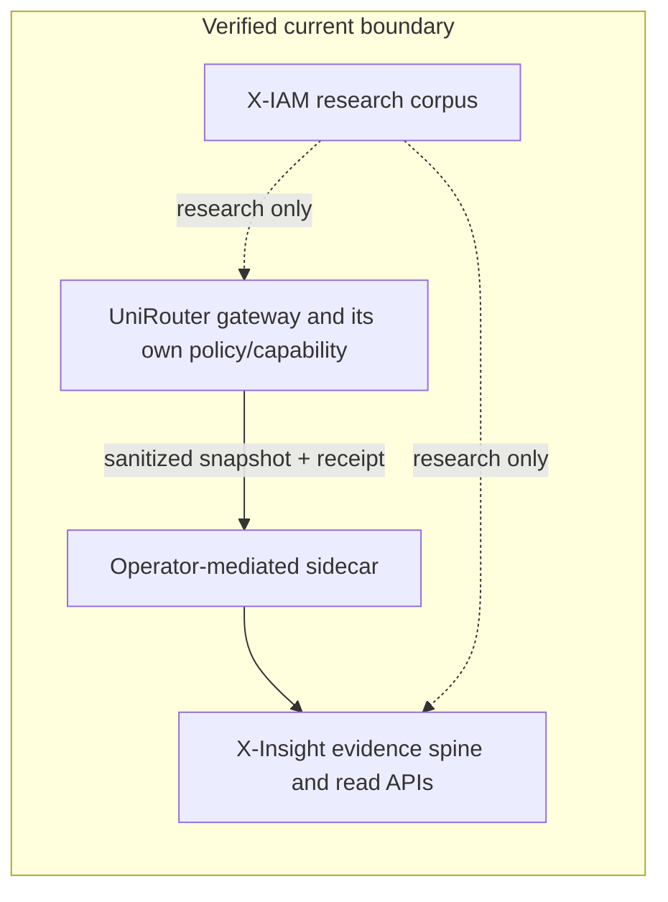
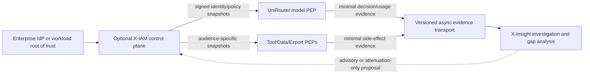

# UniRouter / X-IAM / X-Insight Scalability Anti-Pattern Audit

Status: architecture discussion input; 100x findings are release-gate hypotheses until measured
Date: 2026-07-13
Owner: Codex
Decision owner: User
Original X-Insight audit baseline: `e43add8e0184ba1eb059484053bc5e9d9f4cf6ed`
UniRouter reviewed main: `fbfde8816a6a6676cd0c65a489659d246c5541fd`

Follow-on: the User accepted product defaults B0-D01 through B0-D08 on
2026-07-13. The architecture questions below, including root of trust, Agent
identity units, revocation and delegation custody, remain open. Their detailed
rationale and trade-offs are recorded in the
[X-IAM, Tool Gateway and cache authority boundary](../architecture/phase-2-xiam-tool-gateway-cache-authority-boundary-candidate-2026-07-13.md#rationale-for-prior-decision-questions-2-through-5).

## Executive Finding

There is no verified current “three-runtime” system. UniRouter is the active
gateway/control runtime, X-Insight is an async evidence normalizer and read API,
and X-IAM is currently a non-Git research corpus with no deployable service.
Therefore this audit treats X-IAM as a candidate future identity control plane,
not as an implemented issuer, PDP, PEP or X-Insight dependency.

No new verified P0/P1 was found that reopens X-Insight Phase 1. There is also no
100x or HA evidence for the combined architecture. If 100x throughput, agent
fanout or Production verified becomes a release claim, the current system has
five primary blockers:

1. authorization/admission work can amplify before overload is rejected;
2. PostgreSQL and Redis contain correctness-preserving but potentially hot
   serialization points;
3. evidence generation can multiply request load and compete with control or
   financial work;
4. X-Insight's importer/read surface lacks the hard limits, cursor and capacity
   contract required for a continuous high-volume stream; and
5. authority, revocation, retention, failure and HA semantics are not defined
   across three products.

The central recommendation is not “add Kafka” or “build X-IAM now.” It is to
keep request-path enforcement local to each action owner, distribute signed and
versioned control-plane state, keep X-Insight asynchronous, and require measured
evidence before selecting sharding, queue or analytics infrastructure.

## Audited Reality, Not The Aspirational Diagram

| Plane | Verified current state | This audit does not claim |
| --- | --- | --- |
| UniRouter | Main includes gateway-scoped short-lived Agent capability, attenuating delegation, bounded hierarchy/fanout, shared ancestor budgets, distributed policy/workload admission, routing epochs and an internal PostgreSQL outbox. | No 100x, multi-instance target, machine-level HA or external X-Insight exporter claim. The existing outbox is not authorization for automatic receipt transport. |
| X-IAM | Research, consultant and reference material about identity, delegation, policy and protocols; no authoritative runtime repository or implementation. | It is not currently a token issuer, remote PDP, organization directory or third deployed service. |
| X-Insight | Evidence spine, importer CLI, PostgreSQL persistence and request-ID read APIs; current approved integration is operator-mediated sidecar import. | No frontend, continuous ingestion, auth/RBAC, durable jobs, retention lifecycle, multi-tenancy, HA/DR or Production verified claim. |

UniRouter's completed capability and distributed-budget work materially reduces
the naive “every child receives a root API key” risk. The residual findings
below account for those fixes; they do not repeat the earlier pre-remediation
audit as current truth.

## X-IAM Research Patterns That Must Not Become Runtime Design

The copied X-IAM source is useful research input, but some consultant code is
illustrative pseudocode with unsafe runtime properties. These are rejected
candidate patterns, not deployed vulnerabilities:

Public-copy note: these original references are retained privately and excluded
from this source candidate. The [historical reference index](../reference/x-iam/README.md)
identifies them; the historical line references below do not provide public
verification of their contents.

- the Token Exchange example persists `subject_token` and the newly issued
  bearer token in `delegation_chains`; a runtime may retain only a
  domain-separated token/JTI hash plus issuer, audience, subject epoch, policy
  version and lineage evidence, never reusable bearer material
  (private `phase-3-authorization-detection.md`, line 258);
- credential cleanup is represented by an in-process goroutine sleeping for 24
  hours; credential lifecycle needs durable state, compare-and-swap,
  multi-replica ownership and crash-recoverable expiry
  (private `phase-3-authorization-detection.md`, line 172);
- the CIBA callback example does not establish callback actor authentication,
  tenant binding, replay protection or idempotent state transition; none of it
  should ship without those contracts
  (private `phase-3-authorization-detection.md`, line 233);
- several detector/authorization sketches depend on broad `RawPayload` access,
  which conflicts with the current no-raw X-Insight boundary
  (private `phase-3-authorization-detection.md`, line 441); and
- the aspirational roadmap combines gateway, identity, policy, trace and graph
  analysis into one product boundary. This audit rejects that coupling in favor
  of separately owned control, enforcement and evidence planes
  (private `x-insight-product-roadmap.md`).

## Four Quadrants

The quadrants distinguish verified knowledge from assumptions and fragmented
knowledge that exists in individual repositories but has not yet been converted
into one accepted cross-product contract.

### Known Knowns

- X-Insight is deliberately off the UniRouter request path and consumes only
  operator-mediated, sanitized sidecar evidence.
- UniRouter's Agent capability is gateway-scoped, short-lived and
  attenuation-only; the actual tool, database or export owner must enforce the
  final side effect.
- Current UniRouter main bounds hierarchy depth and workflow Agent count and
  reserves shared ancestor budgets, but its correctness evidence is not 100x
  capacity evidence.
- X-IAM has no runtime; any architecture that makes it a synchronous dependency
  would be a new decision and implementation.
- X-Insight's current importer reads a snapshot into memory and persists a
  batch transaction; its read API silently caps event/gap results and has no
  cursor.
- Local, CI, Target, external integration and Production status are separate.

### Known Unknowns

- “1x” is not quantified: active roots, Agent count, fanout, depth, auth RPS,
  refresh/revoke rate, policy churn, event multiplier, stream duration, tenant
  skew and evidence retention are unknown.
- Revocation SLOs are not allocated by severity: root compromise, workflow
  revoke, routine role change and advisory risk need different bounds.
- There is no accepted authority matrix for human identity, workload identity,
  gateway capability, tool/data capability, policy publication and audit.
- The future evidence transport's delivery guarantee, per-source ordering,
  replay, poison-message and backpressure behavior are not contracted.
- X-Insight normalized-evidence retention and deletion semantics are undecided.
- DB/Redis topology, failover, migration ownership, restore objectives and
  regional boundary are not selected for 100x/HA.

### Unknown Knowns

These are facts already visible in code or project evidence, but easy to miss
when reasoning only from the high-level “three-in-one” diagram:

- a five-minute capability with refresh jitter can still synchronize thousands
  of distinct child refreshes; singleflight for one token does not combine
  different Agent tokens;
- a shared Redis hash slot makes multi-key correctness atomic but also places a
  hot workflow or global admission domain on one serialization point;
- a strict organization wallet row preserves financial correctness but can
  become the throughput ceiling for one dominant tenant;
- “async outbox” still performs a synchronous durable insert on the producer's
  PostgreSQL path and can amplify WAL, connection and storage pressure;
- lowering one global trace sample rate can hide the security denies/revokes
  that must remain complete; and
- a normalized behavior/permission graph is useful for investigation but is an
  unsafe per-request authorization query surface when fanout and edges explode.

### Unknown Unknowns

- Future agent runtimes may create fanout, retry and nested delegation patterns
  that current fixtures do not model.
- A highly skewed tenant, correlated token refresh, mass revoke or control-plane
  recovery may create a burst far above steady-state averages.
- Cross-region clocks, partial rollout of schemas/policy snapshots and delayed
  revocation can create apparently valid but mutually inconsistent decisions.
- New adapters may omit parent edges, reuse identifiers or emit event volume and
  payload shapes outside current assumptions.
- Adversarial agents may intentionally manufacture denial, gap or retry storms
  that turn observability and authorization into resource-exhaustion channels.

Unknown Unknowns cannot be “designed away” in a document. The mitigation is
bounded inputs, explicit epochs, per-tenant budgets, degradation contracts,
fault injection and reversible deployments.

## Agent Fanout And Authorization Avalanche

For constant fanout `F` and delegation depth `D`, the potential Agent count is:

```text
N = 1 + F + F^2 + ... + F^D = (F^(D+1) - 1) / (F - 1), for F > 1
```

This is a stress model, not a measurement. Current UniRouter limits cap the
actual topology, but a 10,000-Agent workflow remains large enough to expose
correlated refresh and hot-key behavior.

A naive future design would perform a remote X-IAM/PDP call for every model or
tool action and recompute every ancestor on each request. Its work grows roughly
as `O(N × calls_per_agent × depth)`. If thousands of tokens share a refresh
window or a root/tenant epoch changes, retries and cache misses can produce an
authorization avalanche.

Current UniRouter mitigations include short-lived gateway-scoped tokens,
attenuating supervisor exchange, bounded depth/fanout, per-token refresh
singleflight, shared workflow revocation and atomic ancestor budgets. They do
not eliminate these conditional scale risks:

- every capability request still needs shared-state validation;
- distinct child-token refreshes are not one coalesced refresh;
- per-instance root-authority caches can miss together after revoke, restart or
  high-cardinality churn;
- one hot workflow updates lineage state in a shared Redis slot; and
- fail-closed Redis or authority uncertainty can convert one dependency outage
  into broad model-call unavailability.

Illustrative, not benchmarked: 10,000 distinct tokens refreshing in a 30-second
window is about 333 refreshes/second for one workflow. Ten thousand active root
authorities with a 15-second cache bound can approach 667 backing refreshes per
second per replica if access and expiry align. These numbers justify a load
scenario; they are not observed production rates.

### Required Authorization Shape

- X-IAM, if created, is a control plane: registry, approval, policy authoring,
  issuer keys, subject epochs and signed snapshot publication.
- It is not a remote per-call PDP and does not store raw traces or the billing
  ledger.
- UniRouter locally verifies a bounded, audience-specific capability and owns
  model-gateway admission, ancestor budget, routing and billing.
- Tool, data, database and export owners remain their own PEPs; a UniRouter
  capability cannot grant a different audience's side effect.
- X-Insight remains async and advisory. Its outage never causes an otherwise
  valid model/tool request to fail, and its analysis cannot grant new authority.

This uses established patterns without selecting dependencies: OAuth Token
Exchange defines subject/actor and delegation semantics ([RFC 8693](https://www.rfc-editor.org/rfc/rfc8693.html)); SPIFFE describes short-lived,
verifiable workload identity delivered through a local Workload API
([concepts](https://spiffe.io/docs/latest/spiffe-about/spiffe-concepts/),
[Workload API](https://spiffe.io/docs/latest/spiffe-specs/spiffe_workload_api/));
OPA bundles show how signed/versioned policy can be distributed for local
evaluation with explicit consistency trade-offs
([bundles](https://www.openpolicyagent.org/docs/management-bundles)). None is an
accepted X-IAM implementation choice yet.

## Current And Proposed Boundaries





The proposed diagram is decision input, not implemented architecture. Until a
joint versioned contract is accepted, the current sidecar remains the only
approved UniRouter/X-Insight transport.

## Anti-Patterns And Concrete Refactors

### 1. Remote PDP On Every Agent Action

**Failure mode.** Network latency and X-IAM availability enter every model/tool
request; recursive delegation multiplies queries; a mass revoke or cache expiry
causes synchronized fallback to the control plane.

**Refactor.** Publish signed, versioned, tenant-scoped identity/policy snapshots;
verify locally at each PEP; use subject/root epochs for bounded revocation;
precompile bounded decisions rather than query the full identity graph. Use
push invalidation plus TTL as a safety bound, with negative caching and jitter.

**Trade-off.** Local decisions tolerate control-plane outages but introduce a
bounded staleness window. The User must choose the revocation SLO and which
classes fail closed.

### 2. Correctness Hotspots Masquerading As Horizontal Scale

**Failure mode.** More replicas do not help when all workload-admission keys use
one Redis slot, a hot workflow mutates every ancestor in one slot/script, or one
organization wallet row is locked for every financial reservation. A noisy
tenant can become the system ceiling.

**Refactor.** Separate global overload protection from tenant/class queues;
shard tenant queues; use short-lived hierarchical quota leases so central/root
state is touched on refill, not every leaf call; precompute lineage-policy
digests; cap Lua prune/scan work; move wallet scale to bounded escrow/sub-wallet
leases or an append-only partitioned reservation ledger while preserving a
provable spending ceiling.

**Trade-off.** Leasing and sharding reduce contention but complicate
reconciliation and can create bounded overshoot. Financial correctness must not
be traded away without an explicit invariant and failure test.

### 3. Admission After Expensive Work

**Failure mode.** A request can consume authentication/governance queries, body
parsing and evidence writes before distributed workload admission rejects it.
At 100x, rejected load can still exhaust DB pools, CPU and WAL.

**Refactor.** Add cheap emergency admission before database-heavy work; cache a
versioned credential/authority snapshot with explicit revoke SLO; perform
tenant/class admission immediately after identity; read only a bounded body;
reserve exact model/cost budget after model/price resolution. Before admission,
emit only bounded counters or mandatory minimal security evidence.

**Trade-off.** Earlier approximate admission can reject work that a later exact
check would accept. Separate protective capacity admission from precise billing
and policy decisions.

### 4. Observability Self-DDoS And Gap Explosion

**Failure mode.** One request produces multiple gateway, policy, billing,
routing, provider and trace events. An “async” PostgreSQL outbox still adds a
synchronous insert and downstream claim/materialize/delete work. Subagent or
denial storms multiply events, while X-Insight duplicates gap evidence into
event and gap views and currently has no continuous-stream backpressure.

**Refactor.** Split evidence into two lanes:

- mandatory, unsampled minimal receipts for grant/deny/revoke, policy mutation,
  financial terminal and material side effects; and
- deterministic, tenant-budgeted diagnostic traces that may degrade or sample,
  with an explicit capture-gap receipt.

Use per-tenant row/byte budgets, bounded queues, separate worker/connection
pools and partitioned batch append. A future X-Insight transport should use
at-least-once delivery, idempotent consumers and per-source order, not global
order. The OpenTelemetry Collector documents queue, retry, batching and
persistent-storage patterns as well as the need to monitor refused/dropped data
([collector](https://opentelemetry.io/docs/collector/),
[troubleshooting](https://opentelemetry.io/docs/collector/troubleshooting/),
[internal telemetry](https://opentelemetry.io/docs/collector/internal-telemetry/)).
This is a pattern reference, not authorization to add an OTel collector now.

**Trade-off.** Sampling reduces storage cost but can bias investigations.
Mandatory security/financial evidence must be defined narrowly enough to remain
affordable and complete.

### 5. Authorization Graph In The Request Path

**Failure mode.** An Agent–Tool–System–Data graph grows by edges, inherited
relationships and version history. Computing transitive closure per request
makes policy cost scale with graph size and turns one graph outage into a global
authorization outage.

**Refactor.** Build the rich identity/behavior graph asynchronously for
investigation. Compile bounded, audience- and tenant-scoped grants/denies into
signed snapshots for PEPs. Keep subject, actor, delegation and policy version in
minimal decision receipts so X-Insight can reconstruct why without running the
hot-path decision.

**Trade-off.** Compilation delays policy availability and needs rollback/epoch
semantics. It is still safer and more measurable than querying an unbounded
graph on every call.

### 6. One Failure Policy For All Planes

**Failure mode.** “Fail closed everywhere” causes an analytics outage to stop
model traffic; “fail open everywhere” turns identity, tenant or budget
uncertainty into unauthorized/costly work.

**Refactor.** Define failure by invariant:

| Uncertain dependency | Required behavior |
| --- | --- |
| Identity, tenant binding, audience, hard budget or final side-effect authority | Fail closed. |
| Fresh control-plane policy | Use only a signed last-known-good snapshot within its accepted TTL; fail closed after expiry. |
| Optional risk/advisory analysis | Continue within existing authority, mark degraded and emit a gap. |
| X-Insight or evidence materialization | Never block the request; retain/buffer the mandatory minimal receipt or produce an explicit evidence-loss alarm. |

**Trade-off.** Multiple failure classes are operationally harder but prevent
one optional service from becoming a global kill switch.

## Three Less-Obvious Future Blind Spots

The first three are the minimum requested hidden risks; all are separate from
the obvious “more Agents means more requests” observation.

| Blind spot | Why it stays hidden | Failure at scale | Concrete decoupling |
| --- | --- | --- | --- |
| Correlated refresh/revocation waves | Steady-state averages hide synchronized TTL, restart and tenant-wide changes. | DB/Redis cache-miss storm, fail-closed cascade and retry amplification. | Randomized refresh windows, push epoch invalidation, bounded negative cache, per-root refresh coalescing, admission for refresh work and mass-revoke fault tests. |
| Correctness hash-slot/row concentration | Atomic scripts and row locks look distributed because clients are replicated. | One workflow/tenant saturates one Redis slot or wallet row; adding app replicas worsens contention. | Hierarchical quota leases, tenant sharding, bounded Lua work, partitioned reservation ledgers and hot-tenant isolation. |
| Evidence/control competition | “Async” describes consumer timing, not the producer's durable insert or shared database. | Trace/gap storms consume WAL, pool and disk needed for auth/billing; reducing all sampling hides critical decisions. | Mandatory versus diagnostic lanes, per-tenant budgets, separate pools/partitions, batch append, explicit gap receipts and async X-Insight consumption. |
| Epoch/schema split brain | Each component can be locally correct at a different version. | One PEP accepts a capability another rejects; evidence cannot explain the decision; rollout rollback reactivates stale authority. | Signed identity/policy/schema versions, monotonic subject epochs, compatibility windows, rollback rules and receipts carrying all evaluated versions. |
| Global ordering assumption | A single timeline appears intuitive in a UI. | Parallel agents, clock skew and retries create false causality or cursor duplicates. | Per-source sequence and idempotency, explicit parent edges, stable chronology cursor, no global causal inference. |

## X-Insight-Specific 100x Blockers

Before X-Insight itself can ingest or serve a 100x workload, it needs:

- a composite indexed execution/run identity and explicit parent-edge model;
- max snapshot bytes, event count, event size and concurrent import limits;
- streaming/chunked/durable import only after its partial-progress contract is
  separately accepted;
- bounded DB pool, query/HTTP timeouts, concurrency admission and explicit 503;
- keyset cursors and honest `total`, page count and `has_more`, without silent
  1,000-event truncation;
- narrow search/timeline projections and only evidence-justified indexes;
- chronology separate from causality;
- capacity metrics and a retention/deletion decision before a continuous stream;
  and
- a reproducible load/failure matrix.

These are recommendations, not current implementation claims. PostgreSQL
partitioning, ClickHouse, an external queue, read replicas and HA are P2 until
measurement identifies the bottleneck.

## Severity And Gate Interpretation

| Rating | Judgment |
| --- | --- |
| Current X-Insight Phase 1 P0/P1 | None found; do not reopen Phase 1. |
| Current Phase 2 P0 | None. The accepted scope is loopback, single deployment, sanitized metadata and no 100x/Production claim. |
| Conditional P0 before 100x/HA or Production claim | Early overload isolation; no remote per-call X-IAM dependency; preservation of billing/tenant/authority invariants; selected DB/Redis failover and restore topology; mandatory evidence lane that cannot be starved by diagnostics. |
| P1 for Batch 1 safety | Bounded X-Insight API/importer/DB/HTTP behavior, stable execution/cursor identity, load model/SLO, identity and failure authority matrix, revocation tests and capacity evidence. |
| P2 / measurement-gated | External queue, partitioning, ClickHouse, read replicas, dedicated scheduler, multi-region, HA/DR, graph store and continuous external exporter. |

“Conditional P0” is a future release gate, not evidence of a current production
incident or permission to reopen a completed phase.

## 100x Acceptance Matrix

First define 1x. At minimum record active roots, active Agents, average/maximum
depth and fanout, admitted RPS, refresh/revoke rate, policy changes/minute,
events/request, stream duration, tenant skew, snapshot sizes, concurrent UI
sessions and retention days.

| Test | Executable evidence | Required invariant |
| --- | --- | --- |
| 1x/10x/100x sanitized load | CPU/RSS; admitted and completed RPS; p95/p99; DB pool/locks/WAL; Redis Lua/slot latency; outbox lag/rows; disk/index growth | Offered requests and 429s are not counted as successful 100x throughput. |
| Agent fanout/depth and hot-root skew | Root and capability auth, sibling contention, 90/9/1 tenant skew, refresh and mass revoke | No ancestor/root budget multiplication; revoke converges within the accepted SLO; one tenant cannot starve others. |
| Import and duplicate storm | One large snapshot, concurrent sources, same-key same/different hash, size-limit rejection | No OOM, partial unrecorded success or silent truncation; idempotency/conflict counts are exact. |
| Search/timeline paging under writes | Multi-page reads with a fixed `as_of`, identical timestamps, clock reversal and source ID collisions | No duplicates/omissions; cross-source requests do not merge; chronology never fabricates causality. |
| Evidence/gap storm | Mandatory and diagnostic lanes at full trace, sampled and degraded modes | Grant/deny/revoke/financial terminal receipts remain complete; diagnostic loss is surfaced as a gap. |
| Dependency fault injection | DB/Redis failover, worker/replica kill, stale policy, X-Insight outage, queue full and recovery | Each plane follows the accepted fail-closed/LKG/degraded behavior; billing exactly-once and mandatory evidence survive or alarm explicitly. |
| Restore and rollback | PITR/restore, schema/policy rollback and mixed-version rollout | Epochs remain monotonic; no stale authority resurrection; evidence explains which versions decided. |

Passing Local or CI load tests creates Local or CI scale evidence only. A Target
run is separately reported. None automatically means external-integration or
Production verified.

## Decisions Required From The User

1. **X-IAM product role.** Recommended: keep it as research/contract work for
   now; do not create a third runtime until an identity-control-plane problem
   and owner are accepted.
2. **Root of trust.** Recommended: enterprise IdP/workload identity owns human
   and workload truth; UniRouter root keys retain gateway/economic scope only.
3. **Agent identity units.** Decide separate identifiers for Agent definition,
   running instance, workflow, invocation and delegated child. Recommended: do
   not reuse one `agent_id` for all five.
4. **Revocation SLO.** Recommended starting proposal: workflow revoke immediate
   through shared state; root/tenant compromise at most 15 seconds; routine
   role/policy change within the signed snapshot TTL. These need load/failure
   proof.
5. **Delegation custody.** Recommended: only the supervisor holds the root key;
   children receive short-lived attenuating, audience-specific capabilities.
6. **Evidence classes and retention.** Decide which receipts are mandatory and
   unsampled, tenant event budgets, normalized-evidence retention and whether
   content analysis will ever be opt-in. Recommended for Batch 1: metadata only,
   no raw content.
7. **Policy authority.** Choose one authoring authority and a signed
   version/epoch/rollback contract before selecting OPA, Cedar or another engine.
8. **100x definition.** Supply or accept a baseline workload; without it, 100x
   is not an executable requirement.
9. **Transport semantics.** Recommended future contract: at-least-once,
   idempotent, per-source ordered, backpressured evidence; keep the current
   manual sidecar until jointly accepted.
10. **Human approval/CIBA timing.** If near-term, first define the approval
    owner, callback authentication, tenant binding, CAS/idempotency, timeout and
    notification-storm controls.

## Source Records

- [Phase 2 Product Priority](../planning/phase-2-product-priority.md)
- [Runtime Contract Capability Status](../architecture/runtime-contract-capability-status.md)
- [X-IAM Source Review](x-iam-source-review-for-x-insight.md)
- [Phase 2 Batch 0 Scope And Decision Register](../planning/phase-2-batch-0-scope-and-decision-register-2026-07-13.md)
- [X-IAM, Tool Gateway And Cache Authority Boundary](../architecture/phase-2-xiam-tool-gateway-cache-authority-boundary-candidate-2026-07-13.md)
- [X-Insight Innovation And Golden Boundary Matrix](phase-2-xinsight-innovation-and-golden-boundary-2026-07-13.md)
- UniRouter `docs/ops/CURRENT-STATUS.md`,
  `docs/ops/evidence/PRD6-B0B-scalability-antipattern-audit-20260711.md`,
  `docs/ops/evidence/PRD6-B1-P6F19A-agent-capability-kernel-local-20260712.md`,
  `docs/ops/evidence/PRD6-B1-P6F19B-agent-ancestor-budget-local-20260712.md`,
  `docs/ops/evidence/PRD6-B1-P6F07-distributed-limit-policy-local-20260712.md`,
  `docs/ops/evidence/PRD6-B1-P6F21-weighted-workload-admission-local-20260712.md`
  and `docs/ops/evidence/PRD6-B3-P6F20-durable-outbox-local-20260712.md`
  at reviewed main `fbfde8816a6a6676cd0c65a489659d246c5541fd`.
